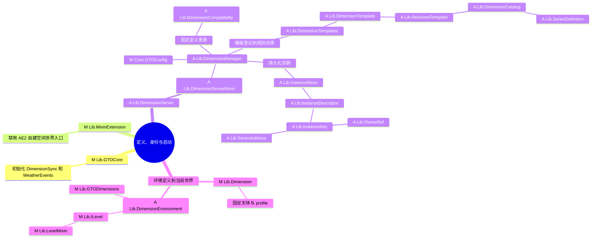
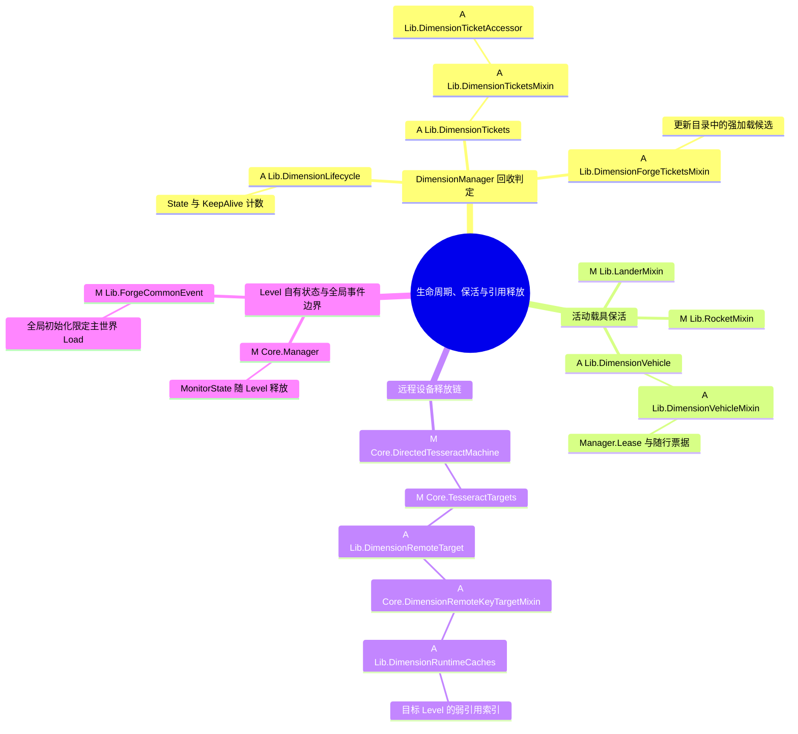
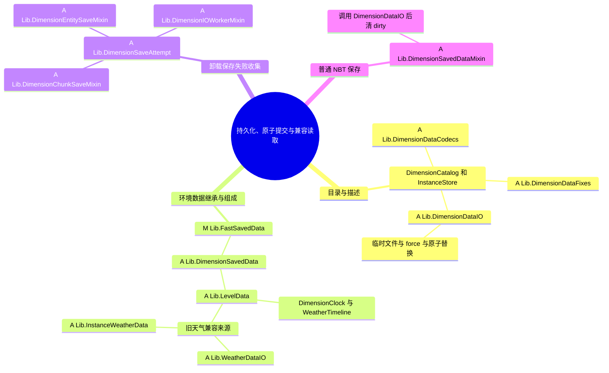
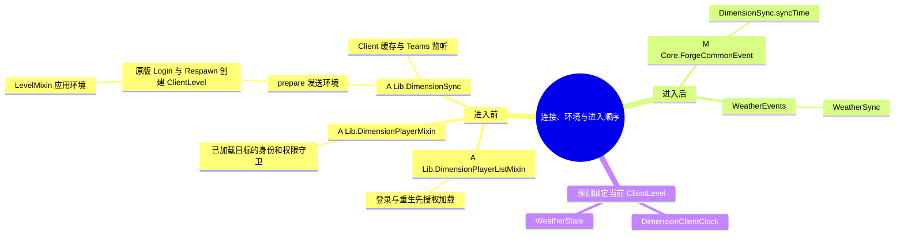
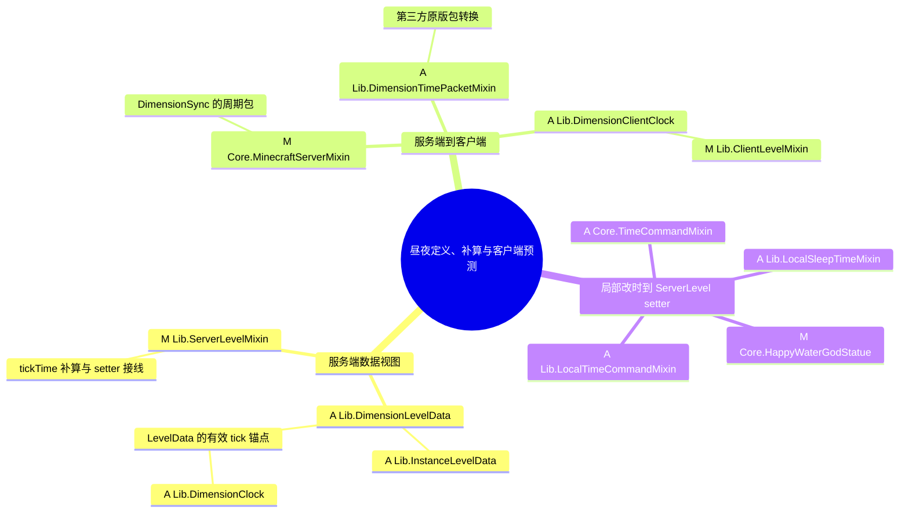
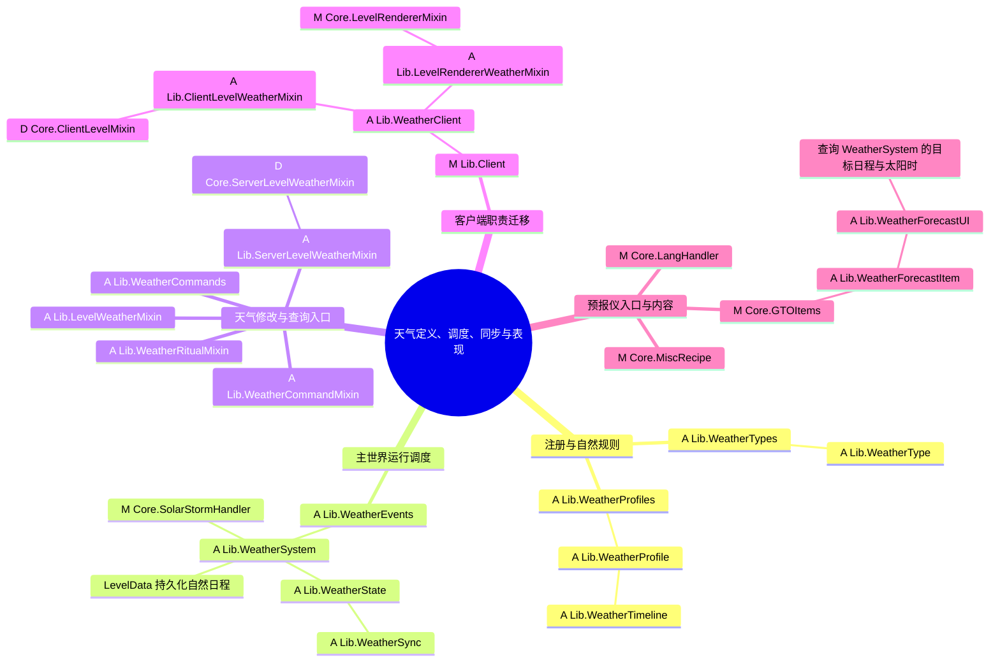
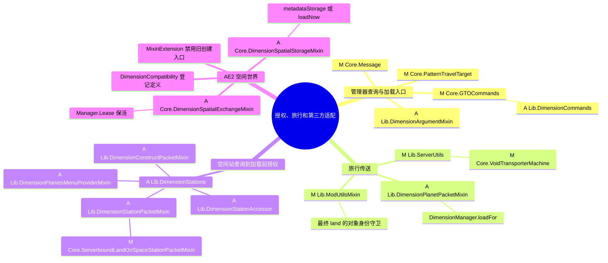
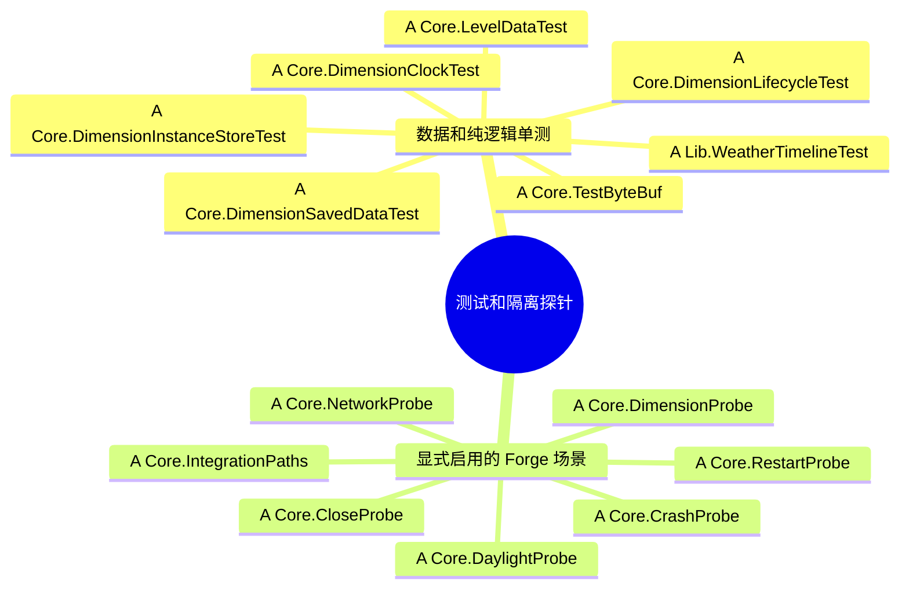
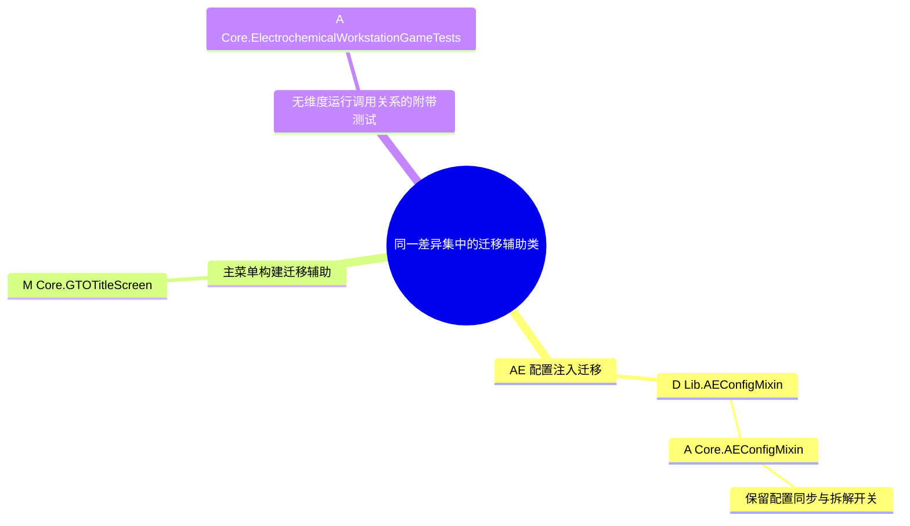

# 维度类关系图：对比 0.6.0

配合 [动态维度系统](dimensions.md) 阅读：主文档说明运行规则，本页逐类连接分支差异。基线为本地 `0.6.0` 的 `3b9ca0f77`，当前主仓为 `a19c312a3`；GTOLib 分别使用它们记录的 `82f7cc14` 与 `414f1dc4`。按两个端点的 `git diff --no-renames` 核对，不混用主仓和子模块历史。

清单覆盖主仓 39 个、GTOLib 90 个发生变化的顶层 Java 类型，共 **129 个**，包含接口、record、测试和删除项；新增的 `package-info.java` 另列于文末。以源文件为核对单位，关键嵌套类型（如 `State`、`KeepAlive`、`Lease`、`MonitorState` 和预报 UI 内部类）随所属类说明。

图例：`A` 新增，`M` 修改，`D` 删除；`Core.` 为主仓 `com.gtocore`，`Lib.` 为 GTOLib `com.gtolib`。思维导图的树枝表示职责归属和接入关系，不代表所有节点都互相强引用。每图下方的源码索引说明实际的调用、实现、持有或迁移方向；删除项只列旧路径，不提供失效链接。

| 主线 | 阅读入口 |
|---|---|
| 启动、模板、地址和世界身份 | [定义图](#map-definitions) → 主文档第 1 节 |
| 空闲、票据、租约和运行引用释放 | [生命周期图](#map-lifecycle) → 主文档第 2 节 |
| 单文件环境数据、创建事务和错误传播 | [存盘图](#map-storage) → 主文档第 4 节 |
| 进入前环境与进入后状态 | [同步图](#map-sync) → [昼夜图](#map-time) → 主文档第 3 节 |
| 自然日程、恒星覆盖、客户端表现和预报 | [天气图](#map-weather) → 主文档第 5 节 |
| 旅行、空间站、AE2 和设备入口 | [适配图](#map-integration) → 主文档第 6 节 |
| 断言入口和分支内附带变化 | [验证图](#map-tests)、[迁移辅助图](#map-support) |

跨图关系要沿下列链路一起看：

- `DimensionServerMixin` → `DimensionManager` → 固定 `LevelStem` 或 `InstanceDescriptor.template` → `DimensionLevelData / InstanceLevelData` → 当前 `ServerLevel`。
- `DimensionManager.running` 持有 `DimensionLifecycle`；保存先经 `DimensionSaveAttempt` 和 IO Mixin，关闭发布 Unload 后由 `DimensionRuntimeCaches` 通知设备释放旧对象。
- `WeatherEvents` → `WeatherSystem` → 主世界 `LevelData` 的共享计数；各维度 `LevelData` → `DimensionClock` 和 `WeatherTimeline`，因此天气与昼夜共用文件而使用不同推进时钟。
- 玩家入口 → 授权和加载 → `DimensionSync.prepare` → 原版进入包 → 时间/天气同步 → 当前 ClientLevel 的 capability；UI 预报另走目标查询同步。
- `DimensionCompatibility` 登记 AE2 定义，`MixinExtension` 停用 AE2 自建世界入口，`DimensionSpatialStorageMixin` 才能将查询和实际交换接到同一管理器。

<a id="map-definitions"></a>

## 1. 定义、身份与启动



| 变化 | 类型与源码 | 与其他类的关系 |
|---|---|---|
| M | [Lib.GTOCore][GTOCore] | 初始化 DimensionSync、WeatherEvents，接到模组启动 |
| M | [Lib.MixinExtension][MixinExtension] | 禁用 AE2 自建空间世界的 MinecraftServerMixin |
| A | [Lib.DimensionServer][DimensionServer] | 为 MinecraftServer 暴露管理器、世界工厂、快照刷新 |
| A | [Lib.DimensionServerMixin][DimensionServerMixin] | 实现服务器桥接，启动主世界并委托其余维度加载 |
| M | [Core.GTOConfig][GTOConfig] | 嵌套 Dimensions 提供懒加载开关、空闲阈值、常驻列表 |
| A | [Lib.DimensionManager][DimensionManager] | 汇合定义、描述、运行对象，协调加载、授权和回收 |
| A | [Lib.DimensionCompatibility][DimensionCompatibility] | 将 AE2 空间 LevelStem 登记为固定定义 |
| A | [Lib.DimensionTemplates][DimensionTemplates] | 登记私人虚空、私人超平坦和主世界噪声模板 |
| A | [Lib.DimensionTemplate][DimensionTemplate] | 模板输入及 SpawnPolicy，交由 ResolvedTemplate 解析 |
| A | [Lib.ResolvedTemplate][ResolvedTemplate] | 冻结 LevelStem JSON、环境和出生策略，重开构造生成定义 |
| A | [Lib.DimensionEnvironment][DimensionEnvironment] | 冻结环境六项，供 Level 运行视图和网络环境使用 |
| A | [Lib.DimensionCatalog][DimensionCatalog] | 保存模板、系列和强加载候选，不枚举全部实例 |
| A | [Lib.OwnerRef][OwnerRef] | 玩家或队伍归属，参与私人身份和权限 |
| A | [Lib.SeriesAddress][SeriesAddress] | 系列 ID 与 long 序号，偏移不创建实例 |
| A | [Lib.SeriesDefinition][SeriesDefinition] | 冻结系列模板、基础种子及默认归属权限 |
| A | [Lib.InstanceKey][InstanceKey] | 规范逻辑键到稳定 UUID，模板版本不参与寻址 |
| A | [Lib.InstanceDescriptor][InstanceDescriptor] | 保存身份、独立种子、冻结模板、归属、访客、出生点 |
| A | [Lib.InstanceStore][InstanceStore] | 描述文件、分页索引、创建日志与 32 条访问缓存 |
| M | [Lib.Dimension][Dimension] | 固定天体选天气 profile，关联既有 CelestialBody |
| M | [Lib.GTODimensions][GTODimensions] | 按服务端描述或客户端缓存识别实例虚空标记 |
| M | [Lib.ILevel][ILevel] | 暴露实例环境应用接口，连接既有世界能力 |
| M | [Lib.LevelMixin][LevelMixin] | 从描述或同步缓存应用实例虚空和 Planet 视图 |

<a id="map-lifecycle"></a>

## 2. 生命周期、保活与引用释放



| 变化 | 类型与源码 | 与其他类的关系 |
|---|---|---|
| A | [Lib.DimensionLifecycle][DimensionLifecycle] | State、空闲起点、KeepAlive 计数；不执行 IO |
| A | [Lib.DimensionTickets][DimensionTickets] | 管理器向 DistanceManager 查询有效运行票据的接口 |
| A | [Lib.DimensionTicketsMixin][DimensionTicketsMixin] | 排除内部和玩家票据后检查其余有效票据 |
| A | [Lib.DimensionTicketAccessor][DimensionTicketAccessor] | 调用 Ticket 的超时判定，避免过期票据保活 |
| A | [Lib.DimensionForgeTicketsMixin][DimensionForgeTicketsMixin] | Forge 票据变更后更新持久化启动候选 |
| A | [Lib.DimensionVehicle][DimensionVehicle] | 活动载具保活接口，由 Entity Mixin 实现 |
| A | [Lib.DimensionVehicleMixin][DimensionVehicleMixin] | 持有 DimensionManager.Lease 与 40 tick 随行票据，移除时释放 |
| M | [Lib.RocketMixin][RocketMixin] | 发射或飞行时通知 DimensionVehicle 保活 |
| M | [Lib.LanderMixin][LanderMixin] | 离地期间通知 DimensionVehicle 保活 |
| M | [Core.DirectedTesseractMachine][DirectedTesseractMachine] | 把目标服务器、维度键和坐标交给 TesseractTargets |
| M | [Core.TesseractTargets][TesseractTargets] | 将地址绑定交给 DimensionRemoteTarget |
| A | [Lib.DimensionRemoteTarget][DimensionRemoteTarget] | 约定按键绑定、按当前 Level 释放 |
| A | [Core.DimensionRemoteKeyTargetMixin][DimensionRemoteKeyTargetMixin] | 实现 GTM RemoteKeyTarget 地址保留、释放和重绑 |
| A | [Lib.DimensionRuntimeCaches][DimensionRuntimeCaches] | 在目标 Level capability 登记弱引用，Unload 只通知相关设备 |
| M | [Core.Manager][Manager] | 监控 MonitorState、队列和网络改为 Level capability，移除全局轴缓存 |
| M | [Lib.ForgeCommonEvent][LibForgeCommonEvent] | Lib 的全局数据初始化限定主世界 Load |

<a id="map-storage"></a>

## 3. 持久化、原子提交与兼容读取



| 变化 | 类型与源码 | 与其他类的关系 |
|---|---|---|
| A | [Lib.DimensionDataCodecs][DimensionDataCodecs] | 编码环境、冻结模板、系列和实例的稳定字段 |
| A | [Lib.DimensionDataFixes][DimensionDataFixes] | 解读 schema 2 历史结构，交给现行对象 |
| A | [Lib.DimensionDataIO][DimensionDataIO] | schema 3 元数据、NBT 和二进制的临时文件加 force 加原子替换 |
| A | [Lib.LevelData][LevelData] | schema 1 环境文件，含 DimensionClock、WeatherTimeline 和补算锚点 |
| A | [Lib.DimensionSavedData][DimensionSavedData] | 复用 SavedData 缓存，现有自有文件读取失败传播 |
| M | [Lib.FastSavedData][FastSavedData] | 普通二进制保存改为原子提交，保留自身版本化读写及 fallback |
| A | [Lib.WeatherDataIO][WeatherDataIO] | 现行日程的稳定天气 key 编码，另含旧 GlobalData 兼容 reader |
| A | [Lib.InstanceWeatherData][InstanceWeatherData] | 仅导入旧实例天气文件，不再承担运行系统独立存盘 |
| A | [Lib.DimensionSaveAttempt][DimensionSaveAttempt] | 卸载和休眠存储保存的线程局部失败作用域 |
| A | [Lib.DimensionSavedDataMixin][DimensionSavedDataMixin] | 普通 SavedData 保留 NBT 格式，原子提交后清 dirty |
| A | [Lib.DimensionChunkSaveMixin][DimensionChunkSaveMixin] | 作用域内区块序列化失败恢复 unsaved 并终止刷新 |
| A | [Lib.DimensionEntitySaveMixin][DimensionEntitySaveMixin] | 作用域内将实体序列化日志错误转为失败 |
| A | [Lib.DimensionIOWorkerMixin][DimensionIOWorkerMixin] | 作用域内等待写入 future；关闭错误始终传播 |

<a id="map-sync"></a>

## 4. 连接、环境与进入顺序



| 变化 | 类型与源码 | 与其他类的关系 |
|---|---|---|
| A | [Lib.DimensionSync][DimensionSync] | dimension_instance 与 dimension_clock；Client 缓存、Teams 权限事件 |
| A | [Lib.DimensionPlayerListMixin][DimensionPlayerListMixin] | 登录重生先授权加载，环境先于 Login 和 Respawn 包 |
| A | [Lib.DimensionPlayerMixin][DimensionPlayerMixin] | 守卫跨 Level 传送，检查当前对象和玩家访问权并 prepare；乘客树检查由 Manager 入口负责 |
| M | [Core.ForgeCommonEvent][CoreForgeCommonEvent] | 登录切维度重生同步时间，虚空入口显式加载，全局 Load 限主世界 |

<a id="map-time"></a>

## 5. 昼夜定义、补算与客户端预测



| 变化 | 类型与源码 | 与其他类的关系 |
|---|---|---|
| A | [Lib.DimensionClock][DimensionClock] | 太阳时与整数余量，按太阳日长度单 tick 或批量推进 |
| A | [Lib.DimensionLevelData][DimensionLevelData] | 非主世界接入 LevelData 时钟，处理 fixed_time 和虚空锁时 |
| A | [Lib.InstanceLevelData][InstanceLevelData] | 继承独立昼夜视图，额外隔离实例种子与出生点 |
| M | [Lib.ServerLevelMixin][ServerLevelMixin] | 接入 tickTime、时间 setter、实例生成种子和原版强加载候选 |
| M | [Core.MinecraftServerMixin][MinecraftServerMixin] | 周期 synchronizeTime 对非主世界改发 dimension_clock |
| A | [Lib.DimensionTimePacketMixin][DimensionTimePacketMixin] | 第三方原版时间包转换为当前维度速率和余量包 |
| A | [Lib.DimensionClientClock][DimensionClientClock] | 当前 ClientLevel capability 中的周期与余量预测 |
| M | [Lib.ClientLevelMixin][LibClientLevelMixin] | 客户端 tickTime 接预测；戴森球显示改时排除太阳表面 |
| A | [Core.TimeCommandMixin][TimeCommandMixin] | 原版 time set 和 add 只处理命令所在世界 |
| M | [Core.HappyWaterGodStatue][HappyWaterGodStatue] | 午夜效果只设置神像所在 ServerLevel |
| A | [Lib.LocalTimeCommandMixin][LocalTimeCommandMixin] | FTB day 和 night 快捷命令局部化 |
| A | [Lib.LocalSleepTimeMixin][LocalSleepTimeMixin] | MythicBotany 睡眠回写睡眠所在世界 |

<a id="map-weather"></a>

## 6. 天气定义、调度、同步与表现



| 变化 | 类型与源码 | 与其他类的关系 |
|---|---|---|
| A | [Lib.WeatherType][WeatherType] | 天气稳定 ID、语言和雨雷语义 |
| A | [Lib.WeatherTypes][WeatherTypes] | 登记所有天气后冻结 Registry，网络整数 ID 的来源 |
| A | [Lib.WeatherProfile][WeatherProfile] | Entry 的权重、时长、浮动与原版天气映射 |
| A | [Lib.WeatherProfiles][WeatherProfiles] | 天体、轨道、实例 profile ID 到自然规则 |
| A | [Lib.WeatherTimeline][WeatherTimeline] | 自然区间、随机状态、恒星恢复边界与预报合成 |
| A | [Lib.WeatherSystem][WeatherSystem] | 主世界 capability 调度，LevelData 存盘，休眠按需补算 |
| A | [Lib.WeatherEvents][WeatherEvents] | tick START、进入同步及主世界保存事件的统一接线 |
| A | [Lib.WeatherState][WeatherState] | 当前类型、起始强度和 gameTime 渐变锚点 |
| A | [Lib.WeatherSync][WeatherSync] | 当前维度键、天气整数 ID、雨和原始雷强度 |
| A | [Lib.LevelWeatherMixin][LevelWeatherMixin] | 接管 Level 查询初始化及强度 setter，客户端 setter 不覆盖系统 |
| A | [Lib.ServerLevelWeatherMixin][LibServerLevelWeatherMixin] | 停用原版循环，接入外部主世界 setter 和本地睡眠清天气 |
| M | [Core.SolarStormHandler][SolarStormHandler] | 实际太阳风暴类型变化到已有 AE 连接和反应堆状态 |
| A | [Lib.WeatherCommands][WeatherCommands] | gtocore weather 注册，按目标 profile 校验并改本地日程 |
| A | [Lib.WeatherCommandMixin][WeatherCommandMixin] | 原版 weather 命令进入本维度显式修改 |
| A | [Lib.WeatherRitualMixin][WeatherRitualMixin] | Ars Cloudshaper 在非主世界结束，遵循外部天气修改边界 |
| M | [Lib.Client][Client] | 客户端初始化 WeatherClient 的显式事件监听 |
| A | [Lib.WeatherClient][WeatherClient] | 特殊降水选择、沙尘粒子雾和太阳天空修正 |
| A | [Lib.ClientLevelWeatherMixin][ClientLevelWeatherMixin] | 承接旧 Core ClientLevelMixin 的太阳天空和闪光修正 |
| A | [Lib.LevelRendererWeatherMixin][LevelRendererWeatherMixin] | 承接 Core LevelRendererMixin 的天气职责并支持特殊降水 |
| M | [Core.LevelRendererMixin][LevelRendererMixin] | 移出天气注入，保留原有天体天空等其他渲染 |
| D | `Core.ClientLevelMixin`（旧路径 `src/main/java/com/gtocore/mixin/mc/client/ClientLevelMixin.java`） | 删除旧太阳天气专用实现，职责迁至 Lib 的天气 Mixin |
| D | `Core.ServerLevelWeatherMixin`（旧路径 `src/main/java/com/gtocore/mixin/mc/ServerLevelWeatherMixin.java`） | 删除旧共享原版天气标志实现，改由 Lib 天气系统接管 |
| M | [Core.GTOItems][GTOItems] | 注册天气预报仪物品 |
| A | [Lib.WeatherForecastItem][WeatherForecastItem] | 物品使用入口打开 WeatherForecastUI |
| A | [Lib.WeatherForecastUI][WeatherForecastUI] | Target、PlanetTab、ForecastSource、ForecastBar 显示目标日程和太阳时 |
| M | [Core.LangHandler][LangHandler] | 生成天气类型、状态、预报与昼夜标记的语言 |
| M | [Core.MiscRecipe][MiscRecipe] | 登记 MV 天气预报仪配方 |

<a id="map-integration"></a>

## 7. 授权、旅行和第三方适配



| 变化 | 类型与源码 | 与其他类的关系 |
|---|---|---|
| M | [Core.GTOCommands][GTOCommands] | 接入 DimensionCommands 与 WeatherCommands 命令树 |
| A | [Lib.DimensionCommands][DimensionCommands] | 维度描述、系列、分页、授权、传送和安全卸载命令 |
| A | [Lib.DimensionArgumentMixin][DimensionArgumentMixin] | 补全固定定义和可访问已加载实例；实际取维度先授权加载 |
| M | [Core.Message][Message] | 远程机器 UI 先检查维度访问权，再查询当前运行目标 |
| M | [Core.PatternTravelTarget][PatternTravelTarget] | 旅行目标名称、图标和可见性查询容忍宿主休眠 |
| A | [Lib.DimensionStations][DimensionStations] | 只用 metadataStorage 读取站点并检查本人、FTB 队伍和 Argonauts 共享归属 |
| A | [Lib.DimensionStationAccessor][DimensionStationAccessor] | 暴露 SpaceStationHandler 的归属索引给元数据查询 |
| A | [Lib.DimensionPlanetsMenuProviderMixin][DimensionPlanetsMenuProviderMixin] | 菜单读取站点和目标信息，不唤醒星球轨道 |
| A | [Lib.DimensionPlanetPacketMixin][DimensionPlanetPacketMixin] | Ad Astra 着陆和建造目标查找改为授权后显式加载 |
| A | [Lib.DimensionStationPacketMixin][DimensionStationPacketMixin] | 空间站着陆先查权限解锁归属，再持 TRANSFER 租约 |
| A | [Lib.DimensionConstructPacketMixin][DimensionConstructPacketMixin] | 建站前检查权限和解锁，轨道加载后持 BUILD 租约 |
| M | [Core.ServerboundLandOnSpaceStationPacketMixin][ServerboundLandOnSpaceStationPacketMixin] | 最终 isAllowed 复用 DimensionStations 归属检查 |
| M | [Lib.ModUtilsMixin][ModUtilsMixin] | 最终 land 拒绝旧 Level、未初始化状态和无权玩家乘客 |
| M | [Lib.ServerUtils][ServerUtils] | 按键入口授权加载，Level 入口校验当前运行对象 |
| M | [Core.VoidTransporterMachine][VoidTransporterMachine] | 传送器先检查玩家和乘客，再 loadFor |
| A | [Core.DimensionSpatialStorageMixin][DimensionSpatialStorageMixin] | AE2 getWorldData 只读元数据，getLevel 显式加载 |
| A | [Core.DimensionSpatialExchangeMixin][DimensionSpatialExchangeMixin] | AE2 空间交换期间持 SPATIAL_EXCHANGE 租约 |

<a id="map-tests"></a>

## 8. 测试和隔离探针



| 变化 | 类型与源码 | 与其他类的关系 |
|---|---|---|
| A | [Core.DimensionLifecycleTest][DimensionLifecycleTest] | 验证空闲、租约、保存取消、关闭和封禁状态转移 |
| A | [Core.DimensionInstanceStoreTest][DimensionInstanceStoreTest] | 验证稳定身份、分页缓存、冻结定义、pending 和历史迁移 |
| A | [Core.DimensionClockTest][DimensionClockTest] | 验证长太阳日的整数余量与保存后继续推进 |
| A | [Core.DimensionSavedDataTest][DimensionSavedDataTest] | 验证 SavedData 二进制原子提交与失败保留 |
| A | [Core.LevelDataTest][LevelDataTest] | 验证统一环境文件、旧时钟导入、补算、损坏与原子失败 |
| A | [Core.TestByteBuf][TestByteBuf] | 为维度单测提供 FriendlyByteBuf 工具 |
| A | [Lib.WeatherTimelineTest][WeatherTimelineTest] | 验证随机序列、恒星覆盖、恢复边界、预报与渐变 |
| A | [Core.DimensionProbe][DimensionProbe] | 隔离模组入口，分派各探针；默认测试生命周期和加载重入 |
| A | [Core.IntegrationPaths][IntegrationPaths] | 验证 AE2、空间站、远程设备等实际兼容入口 |
| A | [Core.DaylightProbe][DaylightProbe] | 验证实际世界昼夜、长期休眠补算、局部改时和预报不加载 |
| A | [Core.RestartProbe][RestartProbe] | 两次启动核对强加载恢复和候选顺序，含 FTB 场景边界 |
| A | [Core.CrashProbe][CrashProbe] | 注入写入失败并异常退出，重启核对已提交状态 |
| A | [Core.CloseProbe][CloseProbe] | 注入关闭故障，验证 POISONED 与拒绝重开 |
| A | [Core.NetworkProbe][NetworkProbe] | 专服双客户端验证进入顺序、环境隔离和网络状态 |

<a id="map-support"></a>

## 9. 同一差异集中的迁移辅助类



| 变化 | 类型与源码 | 与其他类的关系 |
|---|---|---|
| D | `Lib.AEConfigMixin`（旧路径 `GTOLib/src/main/java/com/gtolib/mixin/bootstrap/AEConfigMixin.java`） | 删除旧 Lib bootstrap 位置，配置同步职责迁至 Core |
| A | [Core.AEConfigMixin][CoreAEConfigMixin] | 承接 AEConfig 配置同步及原有便携存储拆解开关 |
| M | [Core.GTOTitleScreen][GTOTitleScreen] | 主菜单回调重排和命名注释；属于构建迁移辅助 |
| A | [Core.ElectrochemicalWorkstationGameTests][ElectrochemicalWorkstationGameTests] | 电化学工作站三种模式 GameTest，与维度生命周期无调用关系 |

## 10. 非类文件与复核方式

新增的 [dimension/package-info.java](../GTOLib/src/main/java/com/gtolib/api/dimension/package-info.java) 说明包级契约，不计入 129 个类型。既有 `CelestialBody`、`NetworkPack`、GTM 的 `RemoteKeyTarget`、`ILevel` capability、原版 `ServerLevel` 和第三方 API 是关系图中的依赖；它们未发生对应 Java 源文件变化时，不标成新增或修改类。

同一分支差异还包含主仓与 Lib 的 Mixin 配置、生成语言和预报仪模型、纹理、Gradle 探针脚本及 schema 2 真实存档样本；这些不是类，分别支撑接线、内容和验证。生成资源仍按 [生成资源规则](generated-resources.md) 修改真实源并运行 runData，不能根据本图直接手改生成文件。

以下命令只读，不切分支或更新子模块。后续分支或 gitlink 前进后，应重新核对图例与清单：

```powershell
git rev-parse 0.6.0 HEAD
git diff --no-renames --name-status 0.6.0 HEAD -- "*.java"
git ls-tree 0.6.0 GTOLib
git ls-tree HEAD GTOLib
git -C GTOLib diff --no-renames --name-status 82f7cc14 414f1dc4 -- "*.java"
```

删除类可用 `git show 0.6.0:<旧路径>` 读取；旧 Lib 类用 `git -C GTOLib show 82f7cc14:<去掉 GTOLib/ 的旧路径>`。本页不把历史分支内出现过、但端点已无差异的类算作变化项。

本次为文档核对：清单按真实 diff 验证完整性；不据此宣称单测、保护构建、服务器或客户端画面已重新通过。验证命令与当前已知缺口见 [主文档第 7 节](dimensions.md#7-操作与验证入口)。

[GTOCore]: ../GTOLib/src/main/java/com/gtolib/GTOCore.java#L33
[MixinExtension]: ../GTOLib/src/main/java/com/gtolib/MixinExtension.java#L32
[DimensionServer]: ../GTOLib/src/main/java/com/gtolib/api/dimension/DimensionServer.java#L13
[DimensionServerMixin]: ../GTOLib/src/main/java/com/gtolib/mixin/mc/DimensionServerMixin.java#L64
[GTOConfig]: ../src/main/java/com/gtocore/config/GTOConfig.java#L35
[DimensionManager]: ../GTOLib/src/main/java/com/gtolib/api/dimension/DimensionManager.java#L57
[DimensionCompatibility]: ../GTOLib/src/main/java/com/gtolib/api/dimension/DimensionCompatibility.java#L13
[DimensionTemplates]: ../GTOLib/src/main/java/com/gtolib/api/dimension/DimensionTemplates.java#L16
[DimensionTemplate]: ../GTOLib/src/main/java/com/gtolib/api/dimension/DimensionTemplate.java#L25
[ResolvedTemplate]: ../GTOLib/src/main/java/com/gtolib/api/dimension/ResolvedTemplate.java#L27
[DimensionEnvironment]: ../GTOLib/src/main/java/com/gtolib/api/dimension/DimensionEnvironment.java#L15
[DimensionCatalog]: ../GTOLib/src/main/java/com/gtolib/api/dimension/DimensionCatalog.java#L17
[OwnerRef]: ../GTOLib/src/main/java/com/gtolib/api/dimension/OwnerRef.java#L14
[SeriesAddress]: ../GTOLib/src/main/java/com/gtolib/api/dimension/SeriesAddress.java#L13
[SeriesDefinition]: ../GTOLib/src/main/java/com/gtolib/api/dimension/SeriesDefinition.java#L18
[InstanceKey]: ../GTOLib/src/main/java/com/gtolib/api/dimension/InstanceKey.java#L16
[InstanceDescriptor]: ../GTOLib/src/main/java/com/gtolib/api/dimension/InstanceDescriptor.java#L23
[InstanceStore]: ../GTOLib/src/main/java/com/gtolib/api/dimension/InstanceStore.java#L18
[Dimension]: ../GTOLib/src/main/java/com/gtolib/api/data/Dimension.java#L26
[GTODimensions]: ../GTOLib/src/main/java/com/gtolib/api/data/GTODimensions.java#L19
[ILevel]: ../GTOLib/src/main/java/com/gtolib/mc/ILevel.java#L18
[LevelMixin]: ../GTOLib/src/main/java/com/gtolib/mixin/mc/world/LevelMixin.java#L37
[DimensionLifecycle]: ../GTOLib/src/main/java/com/gtolib/api/dimension/DimensionLifecycle.java#L11
[DimensionTickets]: ../GTOLib/src/main/java/com/gtolib/api/dimension/DimensionTickets.java#L6
[DimensionTicketsMixin]: ../GTOLib/src/main/java/com/gtolib/mixin/mc/world/DimensionTicketsMixin.java#L19
[DimensionTicketAccessor]: ../GTOLib/src/main/java/com/gtolib/mixin/mc/world/DimensionTicketAccessor.java#L12
[DimensionForgeTicketsMixin]: ../GTOLib/src/main/java/com/gtolib/mixin/forge/DimensionForgeTicketsMixin.java#L20
[DimensionVehicle]: ../GTOLib/src/main/java/com/gtolib/api/dimension/DimensionVehicle.java#L6
[DimensionVehicleMixin]: ../GTOLib/src/main/java/com/gtolib/mixin/mc/entity/DimensionVehicleMixin.java#L26
[RocketMixin]: ../GTOLib/src/main/java/com/gtolib/mixin/adastra/RocketMixin.java#L9
[LanderMixin]: ../GTOLib/src/main/java/com/gtolib/mixin/adastra/LanderMixin.java#L10
[DirectedTesseractMachine]: ../src/main/java/com/gtocore/common/machine/tesseract/DirectedTesseractMachine.java#L68
[TesseractTargets]: ../src/main/java/com/gtocore/common/machine/tesseract/TesseractTargets.java#L13
[DimensionRemoteTarget]: ../GTOLib/src/main/java/com/gtolib/api/dimension/DimensionRemoteTarget.java#L13
[DimensionRemoteKeyTargetMixin]: ../src/main/java/com/gtocore/mixin/gtm/DimensionRemoteKeyTargetMixin.java#L28
[DimensionRuntimeCaches]: ../GTOLib/src/main/java/com/gtolib/api/dimension/DimensionRuntimeCaches.java#L18
[Manager]: ../src/main/java/com/gtocore/common/machine/monitor/Manager.java#L48
[LibForgeCommonEvent]: ../GTOLib/src/main/java/com/gtolib/forge/ForgeCommonEvent.java#L112
[DimensionDataCodecs]: ../GTOLib/src/main/java/com/gtolib/api/dimension/DimensionDataCodecs.java#L16
[DimensionDataFixes]: ../GTOLib/src/main/java/com/gtolib/api/dimension/DimensionDataFixes.java#L14
[DimensionDataIO]: ../GTOLib/src/main/java/com/gtolib/api/dimension/DimensionDataIO.java#L30
[LevelData]: ../GTOLib/src/main/java/com/gtolib/api/dimension/LevelData.java#L18
[DimensionSavedData]: ../GTOLib/src/main/java/com/gtolib/api/dimension/DimensionSavedData.java#L19
[FastSavedData]: ../GTOLib/src/main/java/com/gtolib/api/misc/FastSavedData.java#L27
[WeatherDataIO]: ../GTOLib/src/main/java/com/gtolib/api/weather/WeatherDataIO.java#L19
[InstanceWeatherData]: ../GTOLib/src/main/java/com/gtolib/api/weather/InstanceWeatherData.java#L8
[DimensionSaveAttempt]: ../GTOLib/src/main/java/com/gtolib/api/dimension/DimensionSaveAttempt.java#L9
[DimensionSavedDataMixin]: ../GTOLib/src/main/java/com/gtolib/mixin/mc/world/DimensionSavedDataMixin.java#L23
[DimensionChunkSaveMixin]: ../GTOLib/src/main/java/com/gtolib/mixin/mc/world/DimensionChunkSaveMixin.java#L18
[DimensionEntitySaveMixin]: ../GTOLib/src/main/java/com/gtolib/mixin/mc/world/DimensionEntitySaveMixin.java#L17
[DimensionIOWorkerMixin]: ../GTOLib/src/main/java/com/gtolib/mixin/mc/world/DimensionIOWorkerMixin.java#L25
[DimensionSync]: ../GTOLib/src/main/java/com/gtolib/api/dimension/DimensionSync.java#L31
[DimensionPlayerListMixin]: ../GTOLib/src/main/java/com/gtolib/mixin/mc/DimensionPlayerListMixin.java#L32
[DimensionPlayerMixin]: ../GTOLib/src/main/java/com/gtolib/mixin/mc/entity/DimensionPlayerMixin.java#L28
[CoreForgeCommonEvent]: ../src/main/java/com/gtocore/common/forge/ForgeCommonEvent.java#L120
[DimensionClock]: ../GTOLib/src/main/java/com/gtolib/api/dimension/DimensionClock.java#L6
[DimensionLevelData]: ../GTOLib/src/main/java/com/gtolib/api/dimension/DimensionLevelData.java#L17
[InstanceLevelData]: ../GTOLib/src/main/java/com/gtolib/api/dimension/InstanceLevelData.java#L12
[ServerLevelMixin]: ../GTOLib/src/main/java/com/gtolib/mixin/mc/world/ServerLevelMixin.java#L25
[MinecraftServerMixin]: ../src/main/java/com/gtocore/mixin/mc/MinecraftServerMixin.java#L15
[DimensionTimePacketMixin]: ../GTOLib/src/main/java/com/gtolib/mixin/mc/DimensionTimePacketMixin.java#L16
[DimensionClientClock]: ../GTOLib/src/main/java/com/gtolib/api/dimension/DimensionClientClock.java#L11
[LibClientLevelMixin]: ../GTOLib/src/main/java/com/gtolib/mixin/mc/world/ClientLevelMixin.java#L33
[TimeCommandMixin]: ../src/main/java/com/gtocore/mixin/mc/TimeCommandMixin.java#L14
[HappyWaterGodStatue]: ../src/main/java/com/gtocore/common/block/HappyWaterGodStatue.java#L96
[LocalTimeCommandMixin]: ../GTOLib/src/main/java/com/gtolib/mixin/ftblibrary/LocalTimeCommandMixin.java#L15
[LocalSleepTimeMixin]: ../GTOLib/src/main/java/com/gtolib/mixin/mythicbotany/LocalSleepTimeMixin.java#L12
[WeatherType]: ../GTOLib/src/main/java/com/gtolib/api/weather/WeatherType.java#L6
[WeatherTypes]: ../GTOLib/src/main/java/com/gtolib/api/weather/WeatherTypes.java#L7
[WeatherProfile]: ../GTOLib/src/main/java/com/gtolib/api/weather/WeatherProfile.java#L4
[WeatherProfiles]: ../GTOLib/src/main/java/com/gtolib/api/weather/WeatherProfiles.java#L15
[WeatherTimeline]: ../GTOLib/src/main/java/com/gtolib/api/weather/WeatherTimeline.java#L9
[WeatherSystem]: ../GTOLib/src/main/java/com/gtolib/api/weather/WeatherSystem.java#L38
[WeatherEvents]: ../GTOLib/src/main/java/com/gtolib/api/weather/WeatherEvents.java#L12
[WeatherState]: ../GTOLib/src/main/java/com/gtolib/api/weather/WeatherState.java#L6
[WeatherSync]: ../GTOLib/src/main/java/com/gtolib/api/weather/WeatherSync.java#L8
[LevelWeatherMixin]: ../GTOLib/src/main/java/com/gtolib/mixin/mc/world/LevelWeatherMixin.java#L12
[LibServerLevelWeatherMixin]: ../GTOLib/src/main/java/com/gtolib/mixin/mc/world/ServerLevelWeatherMixin.java#L11
[SolarStormHandler]: ../src/main/java/com/gtocore/integration/ae/SolarStormHandler.java#L26
[WeatherCommands]: ../GTOLib/src/main/java/com/gtolib/api/weather/WeatherCommands.java#L12
[WeatherCommandMixin]: ../GTOLib/src/main/java/com/gtolib/mixin/mc/world/WeatherCommandMixin.java#L14
[WeatherRitualMixin]: ../GTOLib/src/main/java/com/gtolib/mixin/arsnouveau/WeatherRitualMixin.java#L13
[Client]: ../GTOLib/src/main/java/com/gtolib/Client.java#L29
[WeatherClient]: ../GTOLib/src/main/java/com/gtolib/api/weather/client/WeatherClient.java#L18
[ClientLevelWeatherMixin]: ../GTOLib/src/main/java/com/gtolib/mixin/mc/client/ClientLevelWeatherMixin.java#L12
[LevelRendererWeatherMixin]: ../GTOLib/src/main/java/com/gtolib/mixin/mc/client/LevelRendererWeatherMixin.java#L17
[LevelRendererMixin]: ../src/main/java/com/gtocore/mixin/mc/client/LevelRendererMixin.java#L23
[GTOItems]: ../src/main/java/com/gtocore/common/data/GTOItems.java#L91
[WeatherForecastItem]: ../GTOLib/src/main/java/com/gtolib/api/weather/WeatherForecastItem.java#L18
[WeatherForecastUI]: ../GTOLib/src/main/java/com/gtolib/api/weather/WeatherForecastUI.java#L58
[LangHandler]: ../src/main/java/com/gtocore/data/lang/LangHandler.java#L55
[MiscRecipe]: ../src/main/java/com/gtocore/data/recipe/MiscRecipe.java#L56
[GTOCommands]: ../src/main/java/com/gtocore/common/data/GTOCommands.java#L53
[DimensionCommands]: ../GTOLib/src/main/java/com/gtolib/api/dimension/DimensionCommands.java#L42
[DimensionArgumentMixin]: ../GTOLib/src/main/java/com/gtolib/mixin/mc/DimensionArgumentMixin.java#L32
[Message]: ../src/main/java/com/gtocore/client/Message.java#L43
[PatternTravelTarget]: ../src/main/java/com/gtocore/eio_travel/implementations/PatternTravelTarget.java#L38
[DimensionStations]: ../GTOLib/src/main/java/com/gtolib/api/dimension/DimensionStations.java#L26
[DimensionStationAccessor]: ../GTOLib/src/main/java/com/gtolib/mixin/adastra/DimensionStationAccessor.java#L16
[DimensionPlanetsMenuProviderMixin]: ../GTOLib/src/main/java/com/gtolib/mixin/adastra/DimensionPlanetsMenuProviderMixin.java#L23
[DimensionPlanetPacketMixin]: ../GTOLib/src/main/java/com/gtolib/mixin/adastra/DimensionPlanetPacketMixin.java#L25
[DimensionStationPacketMixin]: ../GTOLib/src/main/java/com/gtolib/mixin/adastra/DimensionStationPacketMixin.java#L22
[DimensionConstructPacketMixin]: ../GTOLib/src/main/java/com/gtolib/mixin/adastra/DimensionConstructPacketMixin.java#L21
[ServerboundLandOnSpaceStationPacketMixin]: ../src/main/java/com/gtocore/mixin/adastra/ServerboundLandOnSpaceStationPacketMixin.java#L14
[ModUtilsMixin]: ../GTOLib/src/main/java/com/gtolib/mixin/adastra/ModUtilsMixin.java#L30
[ServerUtils]: ../GTOLib/src/main/java/com/gtolib/utils/ServerUtils.java#L19
[VoidTransporterMachine]: ../src/main/java/com/gtocore/common/machine/multiblock/electric/voidseries/VoidTransporterMachine.java#L32
[DimensionSpatialStorageMixin]: ../src/main/java/com/gtocore/mixin/ae2/DimensionSpatialStorageMixin.java#L19
[DimensionSpatialExchangeMixin]: ../src/main/java/com/gtocore/mixin/ae2/DimensionSpatialExchangeMixin.java#L18
[DimensionLifecycleTest]: ../src/test/java/com/gtolib/api/dimension/DimensionLifecycleTest.java#L10
[DimensionInstanceStoreTest]: ../src/test/java/com/gtolib/api/dimension/DimensionInstanceStoreTest.java#L29
[DimensionClockTest]: ../src/test/java/com/gtolib/api/dimension/DimensionClockTest.java#L9
[DimensionSavedDataTest]: ../src/test/java/com/gtolib/api/dimension/DimensionSavedDataTest.java#L17
[LevelDataTest]: ../src/test/java/com/gtolib/api/dimension/LevelDataTest.java#L25
[TestByteBuf]: ../src/test/java/com/gtolib/api/dimension/TestByteBuf.java#L12
[WeatherTimelineTest]: ../GTOLib/src/test/java/com/gtolib/api/weather/WeatherTimelineTest.java#L35
[DimensionProbe]: ../src/dimensionTest/java/com/gtocore/dimensionprobe/DimensionProbe.java#L29
[IntegrationPaths]: ../src/dimensionTest/java/com/gtocore/dimensionprobe/IntegrationPaths.java#L29
[DaylightProbe]: ../src/dimensionTest/java/com/gtocore/dimensionprobe/DaylightProbe.java#L25
[RestartProbe]: ../src/dimensionTest/java/com/gtocore/dimensionprobe/RestartProbe.java#L19
[CrashProbe]: ../src/dimensionTest/java/com/gtocore/dimensionprobe/CrashProbe.java#L29
[CloseProbe]: ../src/dimensionTest/java/com/gtocore/dimensionprobe/CloseProbe.java#L20
[NetworkProbe]: ../src/dimensionTest/java/com/gtocore/dimensionprobe/NetworkProbe.java#L19
[CoreAEConfigMixin]: ../src/main/java/com/gtocore/mixin/ae2/bootstrap/AEConfigMixin.java#L14
[GTOTitleScreen]: ../src/main/java/com/gtocore/client/screen/GTOTitleScreen.java#L27
[ElectrochemicalWorkstationGameTests]: ../src/gametest/java/com/gtocore/common/machine/multiblock/part/ae/ElectrochemicalWorkstationGameTests.java#L46
