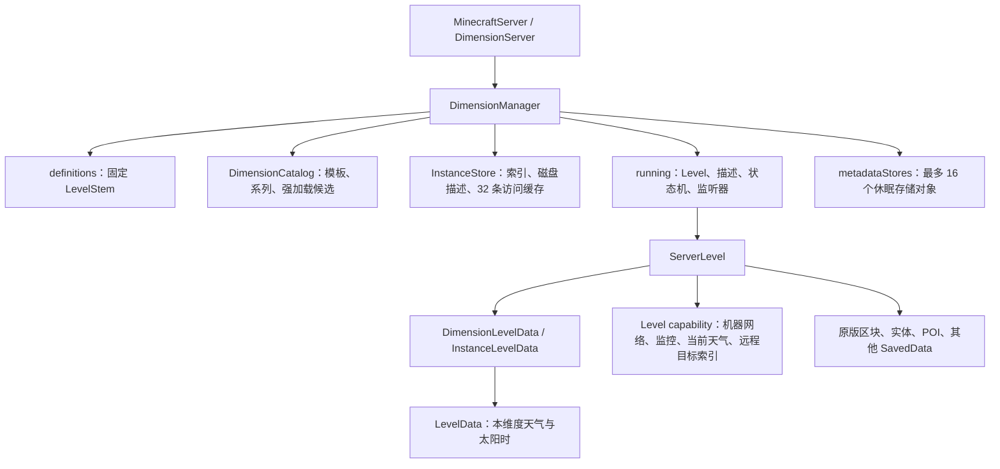
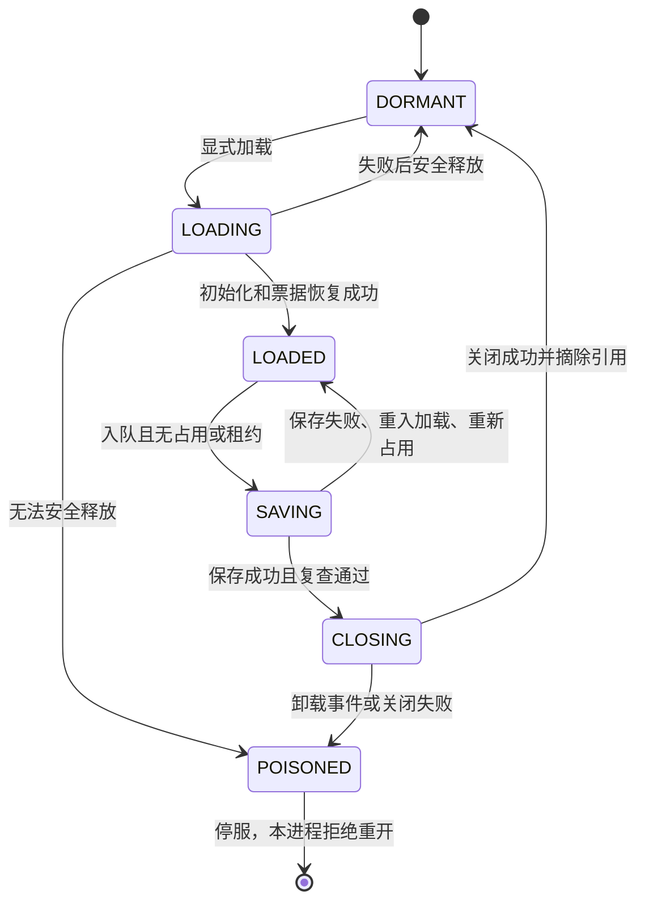
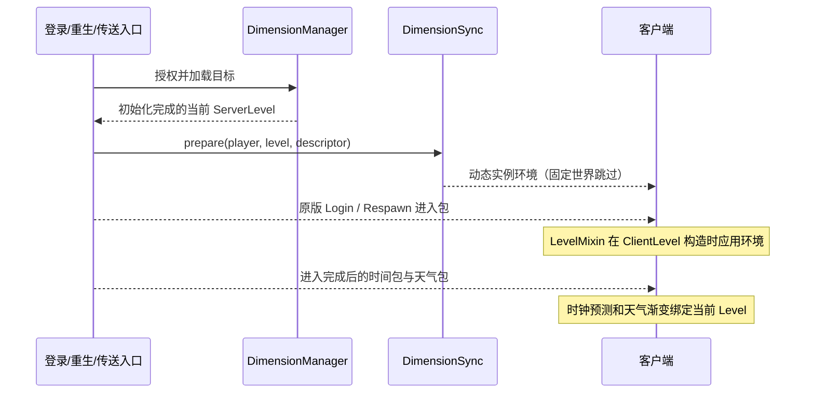
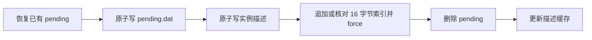
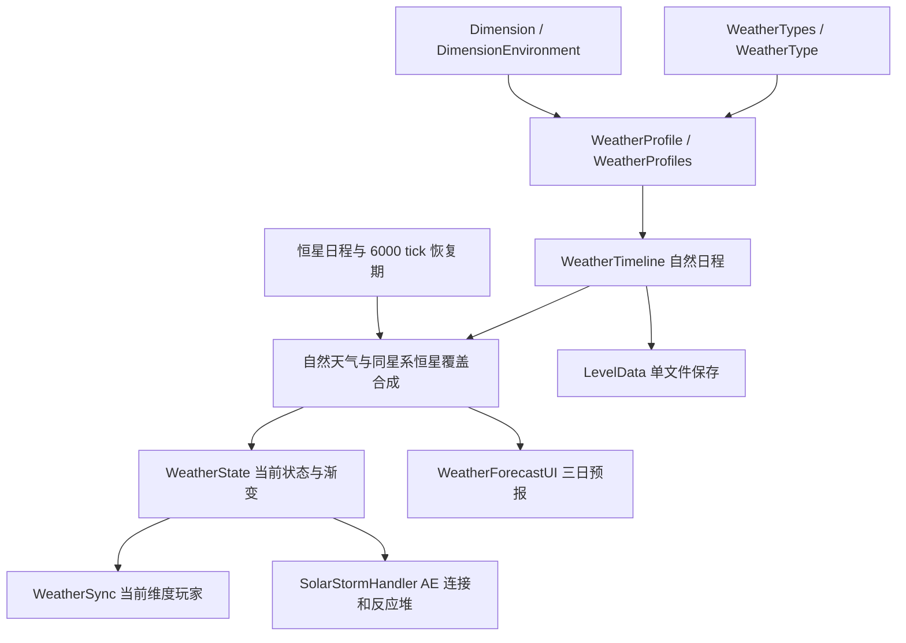

# 动态维度系统

本文按当前 `dynamic-dim2` 源码说明维度的定义、加载与回收、同步、存盘、天气和昼夜。完整的分支差异与类关系见 [维度类关系图：对比 0.6.0](dimension-class-map.md)，天气权重和预报界面细节见 [星系天气](galaxy-weather.md)。

本次核对基线是本地 `0.6.0`（`3b9ca0f77`），当前主仓为 `a19c312a3`；对应 GTOLib 从 `82f7cc14` 对比到 `414f1dc4`。比较的是两个分支端点及各自记录的 gitlink，不是拿主仓分支名直接比较子模块。下文描述源码行为；历史验证记录不代表本次重新执行了游戏测试。

## 1. 定义、实例与运行对象

### 1.1 三类维度与三层身份

| 类别 | 定义和身份 | 何时构造运行世界 |
|---|---|---|
| 主世界 | 注册表中的 `LevelStem.OVERWORLD`；原世界种子 | 启动构造，始终常驻 |
| 固定维度 | 数据包 `LEVEL_STEM` 或 `registerDefinition` 登记的 `LevelStem`；固定维度键 | 按常驻配置、持久化票据或实际访问加载；下界、末地、星球、轨道和 AE2 空间世界均可休眠 |
| 动态实例 | `InstanceDescriptor` 保存逻辑地址、独立种子与冻结模板；键为 `gtocore:instance/<UUID>` | 创建描述不构造 `ServerLevel`，首次实际操作才显式加载；不加入 `LEVEL_STEM` 注册表 |

[DimensionManager] 绑定一个 `MinecraftServer`，通过 [DimensionServer] 接口取得。**登记定义、创建实例描述、加载 `ServerLevel` 是三个不同节点。** 同一个维度键在卸载和重载之间会对应不同的 Level 对象。



### 1.2 地址与冻结定义

私人地址由 `OwnerRef` 的归属种类和 UUID、模板 ID、槽位共同组成；系列地址由系列 ID 和有符号 `long` 序号组成。[InstanceKey] 将各字段用四字节长度前缀加 UTF-8 编码，整体 Base64 保存，再对原始字段字节计算名称 UUID。模板版本不参与寻址，读取时校验文件 UUID 与完整逻辑键，拒绝身份碰撞。

[DimensionTemplate] 是登记入口，[ResolvedTemplate] 冻结完整 `LevelStem` JSON、出生策略和 [DimensionEnvironment]。噪声设置及多噪声预设参数内联，维度类型仍引用已注册 ID。模板升级必须增加版本；同版本不同内容会被拒绝。已有实例和 [SeriesDefinition] 使用创建时快照，不随模板升级改变；冻结定义仍依赖当前注册表里的维度类型、生物群系、方块及生成器 codec。

[DimensionTemplates] 登记 `private_void`、`private_flat` 和 `overworld_noise`。私人实例只在首次创建时采用传入或随机种子；已有实例忽略后来的种子参数。系列规则冻结基础种子、模板和默认权限，再由序号派生实例种子。[SeriesAddress] 的地址偏移采用精确加法，溢出报错；计算相邻地址不创建实例。

环境六项为 `voidWorld`、氧气、重力、开尔文温度、太阳能和天气 profile ID。`private_flat` 当前使用 `DimensionEnvironment.OVERWORLD`，不带虚空标记；固定 `gtocore:flat` 则属于固定虚空集合，两者不能混同。[GTODimensions] 和 [WeatherProfiles] 在服务端主线程查描述，在客户端线程查连接缓存；[LevelMixin] 经 [ILevel] 将实例环境应用到当前 Level 的虚空与 Planet 视图。

### 1.3 查询边界与内存规模

| 对象或入口 | 范围和约定 |
|---|---|
| `definitions` / `fixedDimensionKeys()` | 全部已登记固定定义，包括休眠世界；不包含动态历史 |
| `catalog` | 小型模板、系列规则与强加载候选目录；不保存全部描述 |
| `instances` | 磁盘按 UUID 定位，描述访问缓存最多 32 条；分页只读取对应索引页，页大小 1..100 |
| `running` / `levels()` / `getAllLevels()` | 只枚举初始化完成的运行快照；运行记录会额外持有描述，不受 32 条缓存限制 |
| 内存 `pending` | 单次加载状态机和共享 future；与磁盘创建事务 `pending.dat` 无关 |
| `metadataStorage(key)` | 运行中复用 Level 的存储；休眠时仅打开 `data/`，最多缓存 16 个 `DimensionDataStorage` |
| `WeatherSystem.fixedData` | 已访问固定维度的 `LevelData`，由主世界 capability 上的调度器持有；不受上述 16 个存储对象上限限制 |
| `server.getLevel(key)` | 只查当前世界映射，休眠时返回 `null`；不隐式加载 |
| `isDefined(key)` / `descriptor(key)` | 查询定义或实例描述，不加载地形；未知键也可能返回 `DORMANT`，不能只靠状态判断存在性 |

除了 `load(key)` 可以从其他线程提交到服务器主线程，管理器的查询和修改均按服务器主线程使用。`load` / `loadNow` 是供已授权调用方使用的低层接口，本身不检查玩家权限；玩家或有玩家乘客的实体应走 `loadFor`，安全出生点传送用 `teleport`。

## 2. ServerLevel 生命周期与何时回收

类关系见 [生命周期、保活与引用释放图](dimension-class-map.md#map-lifecycle)。

### 2.1 启动与显式加载

[DimensionServerMixin] 接管 `createLevels`，先打开目录和实例索引，再构造主世界，保留原版出生点、计分板、命令存储、Boss 事件和边界初始化。主世界 `LevelData` 绑定后发布加载事件，登记内置模板及 [DimensionCompatibility] 提供的 AE2 空间维度定义，最后执行 `restoreStartup`。`prepareLevels` 只准备主世界出生区块并恢复其票据。

[GTOConfig] 的默认值是 `dimensions.enabled=true`、`idleTicks=1200`、`residentDimensions=[]`。当前只有主世界强制常驻；下界和末地不默认启动加载。配置指定的常驻维度启动加载。关闭懒加载时，全部固定定义在启动加载，且所有运行维度都跳过安全卸载；动态历史仍不批量构造。

启动恢复对固定定义只检查小型 `chunks` 元数据；动态历史只检查目录中的强加载候选。实际加载后恢复原版强加载，再执行 `ForgeChunkManager.reinstatePersistentChunks` 的 owner、在线和过期等校验回调。候选不等于有效票据；校验后无持久化强加载且非常驻的候选会立即再次休眠。

一次显式 `load(key)` 的顺序为：

1. 切到服务器主线程。已运行则返回；正在加载则复用同一个 future；`SAVING` 中的请求等待保存结束并取消卸载；`CLOSING` 和当前进程内的 `POISONED` 拒绝加载。
2. 找到固定 `LevelStem` 或实例冻结定义；未知键失败。建立内存 `pending`，状态进入 `LOADING`。
3. 若有休眠元数据存储，先受检查地保存，成功后从缓存移除，避免与新 Level 的存储同时维护数据。
4. 经 `gtolib$createLevel` 调用正常 `ServerLevel` 构造器。固定世界用 `DimensionLevelData`，实例用 `InstanceLevelData`。实例独立种子贯穿噪声、结构检查、生成状态和 `getSeed()`；动态实例及 AE2 空间世界使用独立随机序列存储，其他固定世界沿用主世界随机序列。
5. 加载事件前绑定本维度昼夜与天气存储；接入世界边界委托监听、写入服务器映射，发布 `LevelEvent.Load`，恢复真实票据。
6. 全部成功后进入 `LOADED`，加入 `running`，移除 `pending`，重建运行快照及 Forge 世界数组，最后完成 future。

加载事件期间 `getLevel` 可以读到尚在初始化的世界，但它尚未进入运行快照，传送守卫会拒绝进入。`loadNow` 只接受已经完成的 future，初始化回调不能等待自身加载。加载失败且资源能安全释放时回到休眠；构造器抛错后资源无法取得、或清理失败时封禁并停服。

### 2.2 保活与空闲判断

[DimensionManager] 每个服务器 tick 末尾维护生命周期；每 20 tick 只遍历运行快照，复查在线玩家权限、空闲和持久化候选，每 tick 处理卸载队列。

| 条件 | 是否阻止回收 |
|---|---|
| 主世界、配置常驻维度，或已关闭懒加载 | 始终阻止；管理员 `unload` 同样不能绕过 |
| 世界内仍有玩家 | 阻止，并重置空闲起点 |
| 原版或 Forge 持久化强加载 | 阻止；重启时还须校验磁盘票据 |
| 有效运行票据 | 阻止；[DimensionTicketsMixin] 排除 `UNKNOWN`、`LIGHT`、`PLAYER`、`DRAGON`，其余按 [DimensionTicketAccessor] 检查是否过期 |
| 显式租约 | 阻止；[DimensionLifecycle] 按原因维护引用计数，最后一次释放后重新观察空闲 |
| 普通静止实体、仅有描述或天气日程 | 本身不保活；区块和实体在卸载前保存 |
| 查询描述、空间站、AE2 空间元数据或休眠天气预报 | 不构造运行世界，不产生运行保活 |

租约原因有 `TRANSFER`、`ROCKET`、`LANDER`、`BUILD`、`SPATIAL_EXCHANGE` 和 `EXPLICIT`。[DimensionVehicleMixin] 为活动火箭和着陆器维护租约以及随位置移动、40 tick 超时的区块票据；停止、移除或换世界时释放旧票据和租约。[RocketMixin] 和 [LanderMixin] 判定活动状态。租约保证维度运行，需要区块 tick 的任务还须有相应区块票据。

自动卸载必须连续空闲达到 `idleTicks`，默认 1200 tick（正常 20 TPS 下约一分钟），再等周期检查入队；它按服务器 tick 计时，不是墙上时间。管理员 `requestUnload` 可以跳过空闲时长，但实际卸载仍检查常驻、玩家、票据和租约。

### 2.3 回收：保存成功且复查通过才关闭



进入 `SAVING` 后，在 [DimensionSaveAttempt] 作用域中执行 `level.save(null, true, false)`、SavedData 保存和实例描述保存，再更新强加载候选。区块/实体序列化错误和异步区域写入错误必须能阻止关闭。保存失败回到 `LOADED`，保留当前世界并重置空闲计时；保存回调重入的加载请求也会取消此次关闭并取得当前世界。

保存成功后再次检查占用和租约，才进入 `CLOSING`。正常关闭依次发布 `LevelEvent.Unload`、调用 `ServerLevel.close()`、移除边界监听及服务器映射和运行记录、刷新运行快照与 Forge 世界数组，并清理旧世界计时引用。若卸载事件或关闭抛错，则摘除运行引用、记录 `POISONED`、调用 `server.halt(false)`，同一进程中禁止重开。

**这里的回收是关闭运行资源，不删除维度。** 实例描述、分页索引、世界目录、区块和实体保留，后续按同一个键重新加载。当前没有自动删除历史实例或地形的机制。32 条描述缓存、16 个休眠存储对象的淘汰也只释放缓存；它们不触发世界删除。摘除引用后何时真正 GC 由 JVM 决定。

跨维度设备通过 [DimensionRemoteTarget] 保存键与坐标，通过 [DimensionRuntimeCaches] 在目标 Level 的 capability 中登记弱引用。目标卸载只通知相关设备释放 Level、方块实体、监听器和处理器；[DimensionRemoteKeyTargetMixin] 后续只查当前运行世界，重新加载后再绑定，不主动唤醒目标。[DirectedTesseractMachine] → [TesseractTargets] 使用这条路径。[Manager] 的监控网络和待处理队列也改为每 Level capability；这些状态随 Level 释放，不能由一个世界卸载去清空其他世界。

### 2.4 独立昼夜时间

类关系见 [昼夜定义与同步图](dimension-class-map.md#map-time)。

必须区分四种时间：

| 时间 | 定义、推进和暂停 |
|---|---|
| 游戏时间 `gameTime` | 世界 tick、机器及天气渐变使用的时间；非主世界数据视图沿用主世界 |
| 太阳时 `dayTime` | 主世界原版 24000 tick 一天；非主世界按本维度太阳日长度缩放，供太阳/月亮相位和睡眠使用 |
| 有效昼夜计数 | 主世界 `LevelData` 累计的 `daylightTicks`；只在 `doDaylightCycle=true` 时增加，虚空另用排除锁时区间的 `voidDaylightTicks` |
| 天气时钟 `WeatherSystem.clock` | `doWeatherCycle=true` 时每服务器 tick 加一；天气周期与预报范围均使用它，改太阳时不会跳过天气日程 |

[DimensionClock] 用整数太阳时和分数余量推进，等价于每有效 tick 增加 `24000 / dayLength`。批量补算先拆整日再计算余数，不逐 tick 回放，长昼夜不会因取整停滞。[DimensionLevelData] 将此时钟接到 `getDayTime` / `setDayTime`；[InstanceLevelData] 还隔离实例种子和出生点，游戏规则仍共享。

太阳日长度读取既有 [CelestialBody] 的 `dayTicks`，源数据按有方向的自转频率减去绕恒星的公转频率求太阳日；卫星不能用绕母星周期代替恒星年。当前典型值如下，正常 20 TPS 下的实际时长等于倍率乘主世界 20 分钟：

| 天体 | 主世界昼夜倍率 | 一昼夜服务器 tick |
|---|---:|---:|
| 月球 | 29.53063 | 708735 |
| 火星 | 1.02750 | 24660 |
| 水星 | 175.97400 | 4223376 |
| 金星 | 116.75204 | 2802049 |
| 谷神星 | 0.37817 | 9076 |
| 木卫一 | 1.76988 | 42477 |
| 木卫三 | 7.16638 | 171993 |
| 土卫二 | 1.37037 | 32889 |
| 土卫六 | 15.96867 | 383248 |
| 冥王星 | 6.38675 | 153282 |

太阳表面及太阳日为零的绕恒星潮汐锁定天体固定正午 6000；当前包括霜原星和巴纳德 C。无天体定义时默认 24000，维度类型原有 `fixed_time` 保留。固定虚空、固定超平坦和带 `voidWorld` 的实例在 `/gtocore void time` 锁时期间显示 1000；解锁后恢复本维度自己的太阳时。私人超平坦没有该标记。客户端既有戴森球遮蔽显示仍由 `Lib.ClientLevelMixin` 处理，太阳表面排除遮蔽改时。

非主世界运行时在 `ServerLevel.tickTime` 补算；休眠世界重载或查询预报时，用当前有效计数减保存的锚点，一次推进太阳时和余量。`doDaylightCycle=false` 时计数不增加，虚空锁时也不累计对应计数；停服期间不按现实时间补算。若主世界提交计数回退，重新绑定锚点，不倒退本维度太阳时。

没有新时间时，固定维度在天气日程登记时以当时主世界太阳时初始化；动态实例在首次实际加载绑定时初始化。旧独立时钟存在则先导入。主世界仍以原版 24000 推进，`level.dat` 时间保留兼容镜像；`bindOverworld` 从 `LevelData` 恢复时间，主世界 setter 经 [ServerLevelMixin] 回写同一份数据。

`/time set`、`/time add`、睡眠和 [HappyWaterGodStatue] 的午夜效果只改所在维度。[TimeCommandMixin]、FTB 的 [LocalTimeCommandMixin]、MythicBotany 的 [LocalSleepTimeMixin] 分别接入局部入口。Ars 的升阳/落月使用当前 ServerLevel setter；第三方直接发送原版时间包时由 [DimensionTimePacketMixin] 转成带速率和余量的本维度包。

## 3. 网络同步

类关系见 [连接、环境与时钟图](dimension-class-map.md#map-sync)。专用服务器和集成服务器使用同一加载、授权和同步路径；同一 JVM 中的两端也通过连接同步，不能共享服务端描述对象。

### 3.1 同步节点与内容

| 通道或数据 | 触发点与接收者 | 内容与边界 |
|---|---|---|
| 原版 Login / Respawn | 登录、重生、切维度的原有进入流程 | 原版创建 ClientLevel 所需的类型、混淆种子等；登录维度集合为全部固定定义加玩家当前维度，不含全部动态历史 |
| `dimension_instance` | 登录/重生包构造前，或跨 Level 传送前；只发目标玩家 | 维度键、已注册 `DimensionType` 的 VarInt ID、混淆种子、环境六项；不发送生成 JSON、归属、访客或历史目录 |
| `dimension_clock` | 非主世界周期同步，登录/重生/切维度完成，setter 或虚空规则变更；只发所在维度玩家 | 维度键、游戏时间、太阳时、余量、太阳日长度、是否推进；主世界仍用原版时间包 |
| `galaxyWeatherS2C` | 登录/重生/切维度完成、实际天气类型变化 | 维度键、天气注册整数 ID、当前雨强度和原始雷强度；变化只发当前世界玩家 |
| 命令补全 | 客户端按需请求 | 全部固定定义及当前可访问的已加载实例；不扫描历史、不加载世界 |
| 星球菜单 / 预报 UI | 打开界面及其刷新 | 菜单空间站或目标预报所需数据，经各自 UI 协议传输；不广播动态目录 |
| 区块、实体、方块实体、背包 | 原版及模组既有节点 | 继续走已有通道 |

[DimensionSync] 使用 [NetworkPack] 注册两个维度包；[WeatherSync] 注册天气包。维度标识使用 `ByteBufCodecExtends.RESOURCE_LOCATION_CODEC`，天气网络使用 `WeatherTypes.REGISTRY.streamCodec()` 整数 ID；磁盘是另一套协议，不能复用整个 SavedData/NBT 作网络包。

### 3.2 客户端缓存与包顺序



[DimensionPlayerListMixin] 在登录/重生解析目标时先授权并显式加载，无权访问则回退主世界；[DimensionPlayerMixin] 守卫实际传送，拒绝正在初始化或已关闭的旧 Level 对象。环境先于进入包接收；客户端主线程将环境放入连接缓存，即使登录早期没有 player/ClientLevel 也能暂存。后续接收只保留当前及即将进入的动态实例，断线时清空；没有全服目录广播或卸载删除包。

环境接收器会检查已注册的维度类型 ID，但读取的混淆种子不单独应用；实际 ClientLevel 类型和种子仍由原版进入包承载。动态实例复用已在登录注册表同步的 DimensionType，当前协议不支持临时新建客户端未知的类型。

时间包只应用到维度键匹配的当前 ClientLevel。[DimensionClientClock] 在 capability 中保存周期与余量，[LibClientLevelMixin] 以同一整数算法预测；换世界后不复用旧对象。天气包同样检查当前维度，[WeatherState] 用初始强度及 `gameTime` 按需计算每 tick 0.01 的雨/雷渐变，无需每 tick 广播。原版客户端天气包对强度 setter 的写入被 [LevelWeatherMixin] 忽略，天气查询读取系统状态，因此原版字段和包不能覆盖当前天气。

### 3.3 同步不等于保活

服务端单独加载或卸载一个无人维度，不向所有客户端通知目录变化，也不因此生成新的客户端世界。预报和空间站查询可读休眠元数据，但不隐式加载地形。客户端当前/目标环境缓存、Level 上的预测状态、服务端持久化描述有不同生命周期，不能拿其中一份代替其他两份。

## 4. 存盘与错误处理

类关系见 [持久化与兼容读取图](dimension-class-map.md#map-storage)。

### 4.1 哪些数据保存在哪里

以下路径相对世界根目录。维度路径沿用原版：主世界为根，下界 `DIM-1`，末地 `DIM1`，其他世界 `dimensions/<namespace>/<path>`，实例为 `dimensions/gtocore/instance/<UUID>`。

| 文件 / 数据 | 保存内容 | 所有者 |
|---|---|---|
| `gtolib/dimensions/catalog.dat` | 冻结模板、系列规则、持久化强加载启动候选 | [DimensionCatalog] / [DimensionDataIO] |
| `gtolib/dimensions/instances/<UUID前两位>/<UUID>.dat` | 完整逻辑键、种子、序号、冻结模板、归属/访问策略、访客、可选出生点和朝向 | [InstanceStore] / [DimensionDataCodecs] |
| 同实例库的 `instances.index` | 按创建顺序排列的 UUID，每条 16 字节 | [InstanceStore] |
| 同实例库的 `pending.dat` | 尚未完成创建的一个完整描述 | [InstanceStore] 的创建事务 |
| 各维度 `data/gtolib_level.dat` | 太阳时、余量、有效 tick 锚点、周期、虚空/天空光标记、自然天气日程及天气时钟快照 | [LevelData] |
| 主世界同名 `data/gtolib_level.dat` 的额外字段 | 共享天气时钟、两项有效昼夜计数、比邻星和巴纳德虚拟恒星日程 | [LevelData] / [WeatherSystem] |
| 原版/模组原有目录和 SavedData | 区块、实体、POI、随机序列、`chunks.dat`、空间站、AE2 空间区域等 | 原版及各模组 |
| 主世界 `level.dat` | 游戏规则、世界级共享数据、兼容时间镜像等 | 原版；动态实例无独立完整副本 |

运行状态、空闲起点、future、租约、临时飞行票据、Level 引用、监听器和客户端连接缓存不持久化。实例 UUID 和维度键由逻辑键派生，不在描述载荷重复保存。太阳时、天气日程必须在同一个 `LevelData` 文件提交，不能再拆成两个独立现行文件。

### 4.2 何时保存

| 触发 | 行为 |
|---|---|
| 模板/系列登记或强加载候选变更 | 立即原子保存目录；无变更不重复写；IO 失败回滚内存 |
| 首次创建实例 | 提交 pending、描述及索引，不生成地形 |
| 访客授权/撤销、安全传送确定出生点 | 保存对应描述；访客保存失败回滚权限 |
| 实例普通出生点 setter | 先改内存描述，随后世界保存或卸载时持久化 |
| `saveAllChunks` / 正常停服 | 先保存运行实例描述和已缓存休眠存储；运行世界继续原有保存流程 |
| 主世界 `LevelEvent.Save` | `WeatherSystem.saveDormant` 额外提交调度器持有的脏固定维度 LevelData，避免存储缓存淘汰后遗漏 |
| 休眠天气预报 | 扩展天气、补算已有昼夜锚点，立即保存目标 LevelData；不构造世界 |
| 休眠存储缓存满或准备加载该维度 | 先受检查保存，成功后淘汰或移交；失败保留缓存并传播 |
| 安全卸载 | 完整保存世界、SavedData 和描述，确认成功后才关闭 |

正常停服不需要唤醒全部历史实例；已休眠的区块和实体在先前卸载时已经保存。历史描述查询和分页不会批量读取地形。

### 4.3 持久化是在原版上增补，还是重写

维度目录、描述、索引和创建日志是新增文件，由 `DimensionDataIO` / `InstanceStore` 直接管理；实例不靠改写 `level.dat` 的维度注册表保存。世界区块、实体、POI 和第三方 SavedData 保留原有数据格式与路径，卸载过程加强保存错误传播。

[LevelData] 继承 [DimensionSavedData]，复用 SavedData 缓存与保存调度，以一次原子写入提交天气和时间。[WeatherSystem] 是运行调度器，不继承 SavedData。[DimensionSavedDataMixin] 为普通原版 SavedData 保留 `DataVersion + data` 压缩 NBT，并统一原子提交；第三方覆写 `save(File)` 的实现仍由自己负责。[FastSavedData] 也统一原子保存，但保留 DataSyncLib 版本化协议及自己的读取语义。

```text
catalog / instance / pending：GZIP 压缩
  schema[int] = 3
  catalog：templates + series + forced IDs
  instance / pending：logical key + seed + ordinal + frozen template
                     + flags + optional owner / visitors / spawn

gtolib_level.dat：未压缩二进制流（不套普通 FastSavedData 版本前缀）
  schema[int] = 1
  flags[byte]
  optional dayTime[long] + remainder[VarLong]
  optional naturalWeather[timeline]
  optional weatherClockSnapshot[long]
  optional daylightAnchor[long] + dayLength[VarLong] + voidClock + skylight
  optional globalDaylightTicks[long] + globalVoidDaylightTicks[long]
  stars[count + dimension key + timeline]

每条 timeline：randomState + optional lastStormEnd
              + periods[count + stable weather name + start + duration]
```

[DimensionDataCodecs] 使用专用流式磁盘编码，长生成 JSON 使用 VarInt 字节长度加 UTF-8，不受 `writeUTF` 64 KiB 上限限制。枚举固定序号的顺序变更需要迁移；天气磁盘值由 [WeatherDataIO] 的 `WEATHER` 编码为稳定字符串 key，网络另用注册整数 ID。

旧格式按字段按需导入：目录/描述保留 schema 2/3 和历史 `GTDC` 信封读取；旧全局/实例天气保留 schema 2/3 和 `GTWC` 信封读取。`gtocore_galaxy_weather.dat`、`gtocore_instance_weather.dat`、NBT 独立时钟 `gtolib_dimension_clock.dat` 只作为旧档来源；新字段已存在时优先使用新数据，旧文件字节保留且运行系统不再写回。`WeatherDataIO.GlobalData` 和 [InstanceWeatherData] 只服务兼容路径，不能再作为新天气存盘入口。

### 4.4 原子提交与创建事务

单文件保存先写同目录 `<目标>.tmp`，关闭编码流并对临时文件 `force(true)`，再用 `ATOMIC_MOVE + REPLACE_EXISTING` 替换目标。序列化、force 或替换失败均保留旧文件；不支持原子移动时直接报错，不降级直接覆盖。SavedData 仅在提交成功后清 dirty。未提交 `.tmp` 不作为新数据读取。

这只保证单个文件替换，不是整个世界的多文件事务。若维度文件先于主世界时钟提交，重启时 [LevelData] 的 `bindWeatherClock` 按差值平移日程和恒星恢复边界，保留相对阶段与随机状态；昼夜锚点遇到共享计数回退则重新绑定，不回拨太阳时。

创建事务顺序如下：



重启、查询、创建及分页前恢复 pending。恢复必须完整验证载荷、GZIP 尾部、索引位置及已有描述不可变字段；存在匹配描述时保留其最新访客和出生点。pending **只能修复索引尾部一条**，包括长度已满但写入中断的尾记录；不能改写更老记录、填补间隙或覆盖冲突描述。无 pending 的截断索引报错，不扫描历史猜测修复。

强加载候选还有独立提交顺序：新增持久化票据及时登记候选；删除最后一张票据后，如果 `chunks` 仍 dirty，候选必须保留，直到无票据的 `chunks.dat` 成功提交。这样在内存删票据后崩溃，重启仍能找到磁盘旧票据并校验，而不会因候选提前消失漏加载。

### 4.5 保存失败与关闭失败

| 错误 | 当前处理与范围 |
|---|---|
| 自有目录、描述、新 LevelData 或需要导入的旧天气已存在但不可读 | 传播错误，不重建空数据；新 LevelData 还检查 schema、标记和尾部 |
| 目录或访客变更提交失败 | 回滚对应内存变更，保留旧文件 |
| 卸载时区块序列化失败 | [DimensionChunkSaveMixin] 恢复 unsaved 并中止刷新，防止无限重试 |
| 卸载时实体序列化失败 | [DimensionEntitySaveMixin] 将原版只记日志的失败上抛 |
| 卸载时异步区域写入失败 | [DimensionIOWorkerMixin] 在保存作用域内等待 future，使错误阻止卸载 |
| 卸载保存、候选目录提交或休眠元数据保存失败 | 保留运行世界/缓存和 dirty，取消关闭，后续可重试 |
| 卸载事件、资源关闭或初始化失败后的清理不可恢复 | `POISONED`，摘除运行引用，停服；本进程拒绝重开 |

[DimensionSaveAttempt] 的失败收集作用域用于卸载和休眠元数据保存；普通自动保存的区块/实体流程没有整体改成同一套失败收集。普通 SavedData 的原子提交适用于所有保存入口，但不能推广为所有第三方自有 IO 都被接管。

`DimensionSavedData.getFromFile` 对自有环境数据实行读取失败传播；普通 `FastSavedData.getFromFile` 仍保留原有记录错误并回退为空的语义，两者必须区分。没有自动备份修复机制。玩家、区块、实体、POI、`level.dat` 和模组文件仍是多文件保存，异常退出可能回退尚未保存的进度，不能宣称整个存档有同一时刻快照。

## 5. 天气定义、休眠演进与表现

完整类图见 [天气定义、调度、同步与表现](dimension-class-map.md#map-weather)，具体权重表见 [星系天气](galaxy-weather.md)。

[WeatherType] 定义稳定 ID、名称和雨/雷语义；[WeatherTypes] 先登记全部天气，再冻结注册表。[WeatherProfile] 定义自然天气条目、相对权重、基础时长和对称浮动；[WeatherProfiles] 将固定天体、轨道和实例冻结的 profile ID 映射到规则。[Dimension] 为固定天体选择 profile，未指定者默认无大气天气；未登记普通维度回退主世界规则，轨道使用平静规则。



[WeatherSystem] 运行在主世界 capability 上，`WeatherEvents` 于服务器 tick START 推进共享计数。每 tick 只增加有效计数和可运行的天气时钟；到自然日程边界、恒星恢复边界或人工修改时才重新计算运行世界状态。初始化会为已定义天体和轨道建立至少未来 72000 tick 日程；其他固定维度及动态实例按需创建。

[WeatherTimeline] 保存自己的随机状态、当前及未来区间、最近恒星风暴结束点。休眠后扩展会沿原随机状态消费经过的天气区间、补齐预报，而不是从查询时刻重抽；不加载区块，也不遍历全部动态历史。固定日程由调度器持有并在边界扩展；动态实例在实际使用、重载或预报时补算。昼夜按 tick 差值算术补齐，天气则按经过的天气区间补齐，两者算法不同。

同星系且 profile 允许恒星影响的维度，恒星风暴期间覆盖为晴天，风暴结束后覆盖为 6000 tick 雷暴，再回到原自然日程；覆盖不消耗或重抽本地自然天气。无大气天体、轨道及其他星系不受影响。太阳表面使用实际维度日程，比邻星与巴纳德使用主世界 LevelData 中两个虚拟恒星日程，不为它们构造世界。预报用同一个合成算法并合并相邻同类区间。

`doWeatherCycle=false` 暂停天气时钟，显式天气修改仍生效；`/time` 与睡眠不推进天气序列。睡眠清天气仅修改当前维度自然日程，仍可被恒星覆盖。原版 `/weather` 和 `/gtocore weather` 走本维度显式入口，并将 rain 映射为该 profile 的降水或太阳风暴；不支持的天气拒绝。

[LevelWeatherMixin] 接管 Level 的天气查询、雨雷强度和初始化；[LibServerLevelWeatherMixin] 停用原版自然循环并接入 setter、睡眠清天气。直接读写 `ServerLevelData` 的原版天气字段不会改变新系统。外部模组通过 `setWeatherParameters` 或强度 setter 只允许修改主世界，Ars Cloudshaper 的 [WeatherRitualMixin] 在非主世界直接结束。

[WeatherSync] 只在进入节点和天气类型变化时同步当前状态；[WeatherClient] 处理特殊降水、雾、粒子与太阳表现；原版强度写入由 Level 的天气 setter 边界隔离。[ClientLevelWeatherMixin] / [LevelRendererWeatherMixin] 承接原 Core 的太阳天空和降水修正。酸雨、甲烷雨用降雨表现，降雪强制雪，沙尘暴用尘粒与雾；这里没有新增腐蚀伤害或雨水流体。[SolarStormHandler] 从实际天气类型查询太阳风暴，切换时即时更新已有 AE 跨太阳边界连接和反应堆状态。

预报仪由 [GTOItems] → [WeatherForecastItem] → [WeatherForecastUI] 打开；[MiscRecipe] 和 [LangHandler] 提供配方与语言。UI 发送未来 72000 天气 tick 的目标区间、游戏时间、目标太阳时/周期和暂停标记，每秒刷新。休眠查询只读写元数据；日出日落按目标维度太阳日换算，天气时长不缩放。固定时间、无天空光、锁时、昼夜暂停或戴森球遮蔽时按界面条件隐藏标记。

## 6. 入口与兼容边界

完整关系见 [授权、旅行和第三方适配](dimension-class-map.md#map-integration)。

| 入口 | 接入方式 |
|---|---|
| 登录、重生、原版玩家跨维度 | `DimensionPlayerListMixin` / `DimensionPlayerMixin` 登录重生先授权加载，实际传送检查当前运行对象与玩家权限，再同步环境 |
| 虚空/超平坦入口、虚空传送器 | [CoreForgeCommonEvent] / [VoidTransporterMachine] / [ServerUtils] 改用按键授权加载；已有 Level 重载版本拒绝旧运行对象 |
| 星球/轨道着陆、空间站建造 | [DimensionPlanetPacketMixin] 显式加载；[DimensionStationPacketMixin] / [DimensionConstructPacketMixin] 分别检查访问权、星球解锁、站点归属并持租约 |
| 空间站列表与归属 | [DimensionStations] 经 [DimensionStationAccessor] 读 SavedData；[DimensionPlanetsMenuProviderMixin] 不为菜单唤醒地形；[ServerboundLandOnSpaceStationPacketMixin] 复用同一归属检查 |
| Ad Astra 最终着陆 | [ModUtilsMixin] 检查当前 Level 对象身份、LOADED 和玩家乘客树；不能使用同键旧 Level |
| AE2 空间存储 | 禁用依赖自己的空间世界创建 Mixin，固定定义交给管理器；[DimensionSpatialStorageMixin] 分开元数据查询与实际加载，[DimensionSpatialExchangeMixin] 在交换期间持租约 |
| GTM 远程目标 | `DirectedTesseractMachine` → `TesseractTargets` → `DimensionRemoteKeyTargetMixin` → `DimensionRuntimeCaches`，仅绑定当前运行目标 |
| 监控、旅行目标、远程机器 UI | `Manager` 按 Level 管理；[PatternTravelTarget] 容忍休眠目标；[Message] 先检查访问权再查询当前目标 |
| 全局初始化 | Core 与 [LibForgeCommonEvent] 的世界初始化限定主世界，其他 Level 的反复 Load 不重复初始化全局单例 |

实例权限、星球解锁和空间站归属是三次不同判断。实例访问由管理员、公开策略、访客、归属玩家本人或当前所属队伍成员资格决定；队伍已删除时，即使有访客记录也拒绝普通玩家，管理员仍可处理。FTB 队伍变化事件和每 20 tick 的在线复查会将失权玩家送回主世界。拒绝授权不应先加载目标。

新增兼容入口应先判断它是查询元数据还是要操作区块：前者用 `metadataStorage` / 描述，后者先授权、显式加载并按任务持租约。不要永久缓存 Level、区块实体或处理器；不要假设 `getAllLevels()` 是所有历史世界；不要在一次实例卸载中清空其他世界的全局数据。GTM / AE2 内部行为修复的位置仍按 [fork 修改位置](forked-dependencies.md) 判断，本图记录既有实现，不要求继续新增 Mixin。项目固定数据包，不承诺 `/reload` 重建动态定义。

## 7. 操作与验证入口

管理命令由 [GTOCommands] 接入 [DimensionCommands]，根为 `/gtocore dimensions`，均要求权限等级 2。

| 参数 | 作用 |
|---|---|
| `templates` | 列模板及版本 |
| `private create player\|team <UUID> <模板> [槽位 [种子]]` | 创建描述；默认槽位 `main`，不生成地形 |
| `series create <系列ID> [模板 [基础种子 [player\|team <UUID>]]]` | 登记系列，无归属时公开 |
| `series enter <系列ID> <long序号> [玩家选择器]` | 授权后创建或取得实例并安全进入 |
| `info <维度ID>` / `list [页码]` | 状态、种子、归属、租约及历史分页；命令每页 10 条 |
| `tp <维度ID> [玩家选择器]` | 安全出生点传送 |
| `grant\|revoke <维度ID> <访客UUID>` | 持久化授权/撤销并复查在线权限 |
| `load\|unload <维度ID>` | 显式加载/申请安全卸载；不是删除命令 |

类与覆盖范围见 [测试和隔离探针图](dimension-class-map.md#map-tests)。纯文档更新不运行 Gradle；修改生产代码后按 [AGENTS.md](../AGENTS.md) 设置有效 JDK 21、执行相称编译、格式和相关测试；修改 GTOLib 代码必须在收尾通过 `buildGtolibProtected`。

```powershell
$env:JAVA_HOME = '<JDK_21_HOME>'
if (-not (Test-Path -LiteralPath "$env:JAVA_HOME\bin\java.exe")) { throw 'Valid JDK 21 required' }
.\gradlew.bat spotlessApply spotlessCheck test --tests 'com.gtolib.api.dimension.*' --tests 'com.gtolib.api.weather.WeatherTimelineTest' -PgtolibUnprotected=true
# 配置与 EULA 准备好后，在隔离目录运行 Forge 探针
.\gradlew.bat runServer -I gradle/scripts/dimensions-probe.gradle -PgtolibUnprotected=true -PdimensionProbeFTB=false
```

探针开关以 [dimensions-probe.gradle](../gradle/scripts/dimensions-probe.gradle) 和 [DimensionProbe] 的实际分派为准。默认根目录 `build/dimensions-test`，可用 `-PdimensionProbeDir=<隔离目录>` 指定；服务端端口 25577，`online-mode=false` 仅用于本地测试。保持隔离配置 `residentDimensions=[]`，按结果文件和断言判断通过，不只看 Gradle 退出码。

| 验证目标 | 开关 / 入口 |
|---|---|
| 生命周期、授权、重新占用、元数据与远程设备 | 默认 `DimensionProbe` + `IntegrationPaths` |
| 长期休眠、昼夜倍率、暂停、锁时、局部改时、预报不加载地形 | `-PdimensionDaylightProbe=true` |
| 两次启动验证磁盘强加载、候选提交顺序和恢复 | `-PdimensionRestartProbe=true`；无 FTB 核心场景再加 `-PdimensionRestartCoreProbe=true -PdimensionProbeFTB=false` |
| 注入写入失败后异常退出，再启动核对旧文件与磁盘票据 | `-PdimensionCrashProbe=true`，运行两次 |
| 关闭失败、POISONED 与拒绝重开 | `-PdimensionCloseProbe=true` |
| 专服双客户端环境隔离和进入顺序 | `-PdimensionNetworkProbe=true`，客户端分别指定 `DimensionA` / `DimensionB` 的 `-PdimensionClientName` |

当前 checkout 的验证边界仍需保留：`dimensionSuggestionsProbe` 分派所需实现类缺失；完整 FTB 重启场景包含尚未实现的休眠强加载入口。历史隔离运行记录还包含 LeanObject AEKey 启动冲突、加密模式 `AddonFinderMixin` 类加载失败及客户端 datagen 的 gtceu:cover 冻结中断；这些应在目标依赖组合实测，不能用保护构建成功替代游戏运行，也不能宣称客户端画面或集成服务器已验收。

schema 2 迁移单测依赖 `src/test/resources/saved-data/schema-2/` 的真实旧文件；样本缺失时不能宣称验证了历史迁移。此次更新只核对源码、分支类清单、文档链接与图表，不新增编译、服务器或客户端验收结论。

[DimensionServer]: ../GTOLib/src/main/java/com/gtolib/api/dimension/DimensionServer.java#L13
[DimensionServerMixin]: ../GTOLib/src/main/java/com/gtolib/mixin/mc/DimensionServerMixin.java#L64
[GTOConfig]: ../src/main/java/com/gtocore/config/GTOConfig.java#L35
[DimensionManager]: ../GTOLib/src/main/java/com/gtolib/api/dimension/DimensionManager.java#L57
[DimensionCompatibility]: ../GTOLib/src/main/java/com/gtolib/api/dimension/DimensionCompatibility.java#L13
[DimensionTemplates]: ../GTOLib/src/main/java/com/gtolib/api/dimension/DimensionTemplates.java#L16
[DimensionTemplate]: ../GTOLib/src/main/java/com/gtolib/api/dimension/DimensionTemplate.java#L25
[ResolvedTemplate]: ../GTOLib/src/main/java/com/gtolib/api/dimension/ResolvedTemplate.java#L27
[DimensionEnvironment]: ../GTOLib/src/main/java/com/gtolib/api/dimension/DimensionEnvironment.java#L15
[DimensionCatalog]: ../GTOLib/src/main/java/com/gtolib/api/dimension/DimensionCatalog.java#L17
[SeriesAddress]: ../GTOLib/src/main/java/com/gtolib/api/dimension/SeriesAddress.java#L13
[SeriesDefinition]: ../GTOLib/src/main/java/com/gtolib/api/dimension/SeriesDefinition.java#L18
[InstanceKey]: ../GTOLib/src/main/java/com/gtolib/api/dimension/InstanceKey.java#L16
[InstanceStore]: ../GTOLib/src/main/java/com/gtolib/api/dimension/InstanceStore.java#L18
[Dimension]: ../GTOLib/src/main/java/com/gtolib/api/data/Dimension.java#L26
[GTODimensions]: ../GTOLib/src/main/java/com/gtolib/api/data/GTODimensions.java#L19
[ILevel]: ../GTOLib/src/main/java/com/gtolib/mc/ILevel.java#L18
[LevelMixin]: ../GTOLib/src/main/java/com/gtolib/mixin/mc/world/LevelMixin.java#L37
[DimensionLifecycle]: ../GTOLib/src/main/java/com/gtolib/api/dimension/DimensionLifecycle.java#L11
[DimensionTicketsMixin]: ../GTOLib/src/main/java/com/gtolib/mixin/mc/world/DimensionTicketsMixin.java#L19
[DimensionTicketAccessor]: ../GTOLib/src/main/java/com/gtolib/mixin/mc/world/DimensionTicketAccessor.java#L12
[DimensionVehicleMixin]: ../GTOLib/src/main/java/com/gtolib/mixin/mc/entity/DimensionVehicleMixin.java#L26
[RocketMixin]: ../GTOLib/src/main/java/com/gtolib/mixin/adastra/RocketMixin.java#L9
[LanderMixin]: ../GTOLib/src/main/java/com/gtolib/mixin/adastra/LanderMixin.java#L10
[DirectedTesseractMachine]: ../src/main/java/com/gtocore/common/machine/tesseract/DirectedTesseractMachine.java#L68
[TesseractTargets]: ../src/main/java/com/gtocore/common/machine/tesseract/TesseractTargets.java#L13
[DimensionRemoteTarget]: ../GTOLib/src/main/java/com/gtolib/api/dimension/DimensionRemoteTarget.java#L13
[DimensionRemoteKeyTargetMixin]: ../src/main/java/com/gtocore/mixin/gtm/DimensionRemoteKeyTargetMixin.java#L28
[DimensionRuntimeCaches]: ../GTOLib/src/main/java/com/gtolib/api/dimension/DimensionRuntimeCaches.java#L18
[Manager]: ../src/main/java/com/gtocore/common/machine/monitor/Manager.java#L48
[LibForgeCommonEvent]: ../GTOLib/src/main/java/com/gtolib/forge/ForgeCommonEvent.java#L112
[DimensionDataCodecs]: ../GTOLib/src/main/java/com/gtolib/api/dimension/DimensionDataCodecs.java#L16
[DimensionDataIO]: ../GTOLib/src/main/java/com/gtolib/api/dimension/DimensionDataIO.java#L30
[LevelData]: ../GTOLib/src/main/java/com/gtolib/api/dimension/LevelData.java#L18
[DimensionSavedData]: ../GTOLib/src/main/java/com/gtolib/api/dimension/DimensionSavedData.java#L19
[FastSavedData]: ../GTOLib/src/main/java/com/gtolib/api/misc/FastSavedData.java#L27
[WeatherDataIO]: ../GTOLib/src/main/java/com/gtolib/api/weather/WeatherDataIO.java#L19
[InstanceWeatherData]: ../GTOLib/src/main/java/com/gtolib/api/weather/InstanceWeatherData.java#L8
[DimensionSaveAttempt]: ../GTOLib/src/main/java/com/gtolib/api/dimension/DimensionSaveAttempt.java#L9
[DimensionSavedDataMixin]: ../GTOLib/src/main/java/com/gtolib/mixin/mc/world/DimensionSavedDataMixin.java#L23
[DimensionChunkSaveMixin]: ../GTOLib/src/main/java/com/gtolib/mixin/mc/world/DimensionChunkSaveMixin.java#L18
[DimensionEntitySaveMixin]: ../GTOLib/src/main/java/com/gtolib/mixin/mc/world/DimensionEntitySaveMixin.java#L17
[DimensionIOWorkerMixin]: ../GTOLib/src/main/java/com/gtolib/mixin/mc/world/DimensionIOWorkerMixin.java#L25
[DimensionSync]: ../GTOLib/src/main/java/com/gtolib/api/dimension/DimensionSync.java#L31
[DimensionPlayerListMixin]: ../GTOLib/src/main/java/com/gtolib/mixin/mc/DimensionPlayerListMixin.java#L32
[DimensionPlayerMixin]: ../GTOLib/src/main/java/com/gtolib/mixin/mc/entity/DimensionPlayerMixin.java#L28
[CoreForgeCommonEvent]: ../src/main/java/com/gtocore/common/forge/ForgeCommonEvent.java#L120
[DimensionClock]: ../GTOLib/src/main/java/com/gtolib/api/dimension/DimensionClock.java#L6
[DimensionLevelData]: ../GTOLib/src/main/java/com/gtolib/api/dimension/DimensionLevelData.java#L17
[InstanceLevelData]: ../GTOLib/src/main/java/com/gtolib/api/dimension/InstanceLevelData.java#L12
[ServerLevelMixin]: ../GTOLib/src/main/java/com/gtolib/mixin/mc/world/ServerLevelMixin.java#L25
[DimensionTimePacketMixin]: ../GTOLib/src/main/java/com/gtolib/mixin/mc/DimensionTimePacketMixin.java#L16
[DimensionClientClock]: ../GTOLib/src/main/java/com/gtolib/api/dimension/DimensionClientClock.java#L11
[LibClientLevelMixin]: ../GTOLib/src/main/java/com/gtolib/mixin/mc/world/ClientLevelMixin.java#L33
[TimeCommandMixin]: ../src/main/java/com/gtocore/mixin/mc/TimeCommandMixin.java#L14
[HappyWaterGodStatue]: ../src/main/java/com/gtocore/common/block/HappyWaterGodStatue.java#L96
[LocalTimeCommandMixin]: ../GTOLib/src/main/java/com/gtolib/mixin/ftblibrary/LocalTimeCommandMixin.java#L15
[LocalSleepTimeMixin]: ../GTOLib/src/main/java/com/gtolib/mixin/mythicbotany/LocalSleepTimeMixin.java#L12
[WeatherType]: ../GTOLib/src/main/java/com/gtolib/api/weather/WeatherType.java#L6
[WeatherTypes]: ../GTOLib/src/main/java/com/gtolib/api/weather/WeatherTypes.java#L7
[WeatherProfile]: ../GTOLib/src/main/java/com/gtolib/api/weather/WeatherProfile.java#L4
[WeatherProfiles]: ../GTOLib/src/main/java/com/gtolib/api/weather/WeatherProfiles.java#L15
[WeatherTimeline]: ../GTOLib/src/main/java/com/gtolib/api/weather/WeatherTimeline.java#L9
[WeatherSystem]: ../GTOLib/src/main/java/com/gtolib/api/weather/WeatherSystem.java#L38
[WeatherState]: ../GTOLib/src/main/java/com/gtolib/api/weather/WeatherState.java#L6
[WeatherSync]: ../GTOLib/src/main/java/com/gtolib/api/weather/WeatherSync.java#L8
[LevelWeatherMixin]: ../GTOLib/src/main/java/com/gtolib/mixin/mc/world/LevelWeatherMixin.java#L12
[LibServerLevelWeatherMixin]: ../GTOLib/src/main/java/com/gtolib/mixin/mc/world/ServerLevelWeatherMixin.java#L11
[SolarStormHandler]: ../src/main/java/com/gtocore/integration/ae/SolarStormHandler.java#L26
[WeatherRitualMixin]: ../GTOLib/src/main/java/com/gtolib/mixin/arsnouveau/WeatherRitualMixin.java#L13
[WeatherClient]: ../GTOLib/src/main/java/com/gtolib/api/weather/client/WeatherClient.java#L18
[ClientLevelWeatherMixin]: ../GTOLib/src/main/java/com/gtolib/mixin/mc/client/ClientLevelWeatherMixin.java#L12
[LevelRendererWeatherMixin]: ../GTOLib/src/main/java/com/gtolib/mixin/mc/client/LevelRendererWeatherMixin.java#L17
[GTOItems]: ../src/main/java/com/gtocore/common/data/GTOItems.java#L91
[WeatherForecastItem]: ../GTOLib/src/main/java/com/gtolib/api/weather/WeatherForecastItem.java#L18
[WeatherForecastUI]: ../GTOLib/src/main/java/com/gtolib/api/weather/WeatherForecastUI.java#L58
[LangHandler]: ../src/main/java/com/gtocore/data/lang/LangHandler.java#L55
[MiscRecipe]: ../src/main/java/com/gtocore/data/recipe/MiscRecipe.java#L56
[GTOCommands]: ../src/main/java/com/gtocore/common/data/GTOCommands.java#L53
[DimensionCommands]: ../GTOLib/src/main/java/com/gtolib/api/dimension/DimensionCommands.java#L42
[Message]: ../src/main/java/com/gtocore/client/Message.java#L43
[PatternTravelTarget]: ../src/main/java/com/gtocore/eio_travel/implementations/PatternTravelTarget.java#L38
[DimensionStations]: ../GTOLib/src/main/java/com/gtolib/api/dimension/DimensionStations.java#L26
[DimensionStationAccessor]: ../GTOLib/src/main/java/com/gtolib/mixin/adastra/DimensionStationAccessor.java#L16
[DimensionPlanetsMenuProviderMixin]: ../GTOLib/src/main/java/com/gtolib/mixin/adastra/DimensionPlanetsMenuProviderMixin.java#L23
[DimensionPlanetPacketMixin]: ../GTOLib/src/main/java/com/gtolib/mixin/adastra/DimensionPlanetPacketMixin.java#L25
[DimensionStationPacketMixin]: ../GTOLib/src/main/java/com/gtolib/mixin/adastra/DimensionStationPacketMixin.java#L22
[DimensionConstructPacketMixin]: ../GTOLib/src/main/java/com/gtolib/mixin/adastra/DimensionConstructPacketMixin.java#L21
[ServerboundLandOnSpaceStationPacketMixin]: ../src/main/java/com/gtocore/mixin/adastra/ServerboundLandOnSpaceStationPacketMixin.java#L14
[ModUtilsMixin]: ../GTOLib/src/main/java/com/gtolib/mixin/adastra/ModUtilsMixin.java#L30
[ServerUtils]: ../GTOLib/src/main/java/com/gtolib/utils/ServerUtils.java#L19
[VoidTransporterMachine]: ../src/main/java/com/gtocore/common/machine/multiblock/electric/voidseries/VoidTransporterMachine.java#L32
[DimensionSpatialStorageMixin]: ../src/main/java/com/gtocore/mixin/ae2/DimensionSpatialStorageMixin.java#L19
[DimensionSpatialExchangeMixin]: ../src/main/java/com/gtocore/mixin/ae2/DimensionSpatialExchangeMixin.java#L18
[DimensionProbe]: ../src/dimensionTest/java/com/gtocore/dimensionprobe/DimensionProbe.java#L29
[CelestialBody]: ../GTOLib/src/main/java/com/gtolib/api/data/CelestialBody.java
[NetworkPack]: ../GTOLib/src/main/java/com/gtolib/api/network/NetworkPack.java
